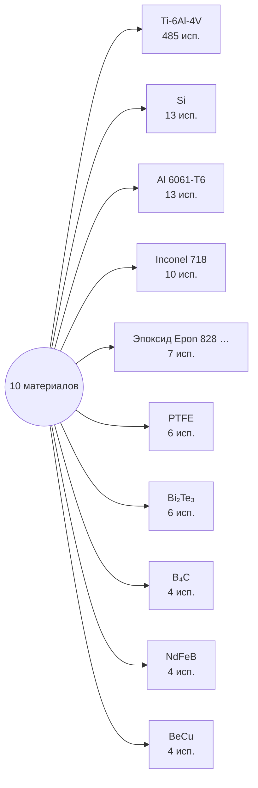

# Граф 1 — топ-10 материалов по использованию

| Материал | Используется в частях |
|---|---:|
| `Ti-6Al-4V` | 485 |
| `Si` | 13 |
| `Al 6061-T6` | 13 |
| `Inconel 718` | 10 |
| `Эпоксид Epon 828 + TETA` | 7 |
| `PTFE` | 6 |
| `Bi₂Te₃` | 6 |
| `B₄C` | 4 |
| `NdFeB` | 4 |
| `BeCu` | 4 |
