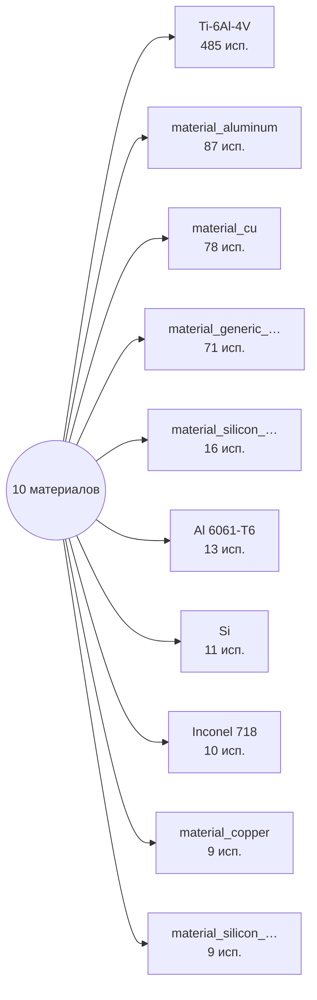

# Граф 1 — топ-10 материалов по использованию

| Материал | Используется в частях |
|---|---:|
| `Ti-6Al-4V` | 485 |
| `material_aluminum` | 87 |
| `material_cu` | 78 |
| `material_generic_material` | 71 |
| `material_silicon_wafer` | 16 |
| `Al 6061-T6` | 13 |
| `Si` | 11 |
| `Inconel 718` | 10 |
| `material_copper` | 9 |
| `material_silicon_carbide` | 9 |
