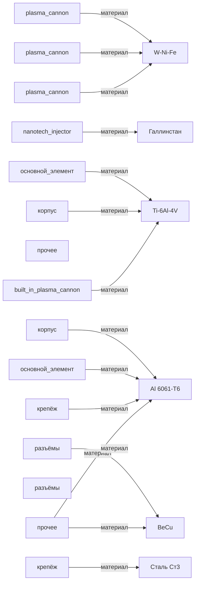

# Граф 1 — подсистема «встроенное_оружие»

| Материал | Используется в частях |
|---|---:|
| `Al 6061-T6` | 4 |
| `W-Ni-Fe` | 3 |
| `Ti-6Al-4V` | 3 |
| `BeCu` | 2 |
| `Галлинстан` | 1 |
| `Сталь Ст3` | 1 |
