# Граф 1 — подсистема «каркас»

```mermaid
graph LR
    izdelie_SkyNet_Cameron[модель_обёртка]
    izdelie_SkyNet_HKAerial[модель_обёртка]
    izdelie_reshetchatyi_karkas[прочее]
    izdelie_SkyNet_Rev9[модель_обёртка]
    izdelie_SkyNet_MarcusWright[модель_обёртка]
    izdelie_SkyNet_T600[модель_обёртка]
    izdelie_SkyNet_HKTank[модель_обёртка]
    izdelie_kompensatory[прочее]
    izdelie_SkyNet_TX[модель_обёртка]
    izdelie_SkyNet_T800[модель_обёртка]
    izdelie_SkyNet_T850[модель_обёртка]
    часть_cameron_эндоскелет[titanium_endoskeleton_small]
    часть_hk_aerial_крылья[wings]
    часть_hk_aerial_фюзеляж[fuselage]
    часть_reshetchatyi_karkas_mounting[крепёж]
    часть_reshetchatyi_karkas_connectors[разъёмы]
    часть_reshetchatyi_karkas_core[основной_элемент]
    часть_reshetchatyi_karkas_housing[корпус]
    часть_rev9_endoskeleton[carbon_endoskeleton]
    часть_marcus_эндоскелет[cybernetic_endoskeleton]
    часть_t600_эндоскелет[titanium_endoskeleton]
    часть_hk_tank_корпус[tank_body]
    часть_hk_tank_башня[turret]
    часть_kompensatory_mounting[крепёж]
    часть_kompensatory_connectors[разъёмы]
    часть_kompensatory_housing[корпус]
    часть_kompensatory_core[основной_элемент]
    часть_t_x_эндоскелет[hyperalloy_endoskeleton_tx]
    часть_t800_эндоскелет_торс[hyperalloy_endoskeleton]
    часть_t850_эндоскелет[hyperalloy_endoskeleton]
    material_ti_6al_4v[Ti-6Al-4V]
    material_inconel_718[Inconel 718]
    izdelie_SkyNet_HKAerial -->|материал| material_inconel_718
    izdelie_SkyNet_HKAerial -->|материал| material_inconel_718
    izdelie_reshetchatyi_karkas -->|материал| material_generic_material
    izdelie_reshetchatyi_karkas -->|материал| material_aluminum
    izdelie_kompensatory -->|материал| material_generic_material
    izdelie_kompensatory -->|материал| material_aluminum
    часть_cameron_эндоскелет -->|материал| material_ti_6al_4v
    часть_hk_aerial_крылья -->|материал| material_ti_6al_4v
    часть_hk_aerial_фюзеляж -->|материал| material_ti_6al_4v
    часть_reshetchatyi_karkas_mounting -->|материал| material_ti_6al_4v
    часть_reshetchatyi_karkas_connectors -->|материал| material_cu
    часть_reshetchatyi_karkas_core -->|материал| material_ti_6al_4v
    часть_reshetchatyi_karkas_housing -->|материал| material_ti_6al_4v
    часть_marcus_эндоскелет -->|материал| material_ti_6al_4v
    часть_t600_эндоскелет -->|материал| material_ti_6al_4v
    часть_hk_tank_корпус -->|материал| material_ti_6al_4v
    часть_hk_tank_башня -->|материал| material_ti_6al_4v
    часть_kompensatory_mounting -->|материал| material_ti_6al_4v
    часть_kompensatory_connectors -->|материал| material_cu
    часть_kompensatory_housing -->|материал| material_ti_6al_4v
    часть_kompensatory_core -->|материал| material_ti_6al_4v
    часть_t_x_эндоскелет -->|материал| material_ti_6al_4v
    часть_t800_эндоскелет_торс -->|материал| material_ti_6al_4v
    часть_t850_эндоскелет -->|материал| material_ti_6al_4v
```

_Показаны 5 наиболее часто используемых материалов (полный список — в graph1_data.json)._

| Материал | Используется в частях |
|---|---:|
| `Ti-6Al-4V` | 16 |
| `material_hyperalloy_t800` | 5 |
| `material_living_tissue_clone` | 4 |
| `material_titanium_alloy` | 3 |
| `Inconel 718` | 2 |
| `material_tungsten_alloy` | 2 |
| `material_generic_material` | 2 |
| `material_aluminum` | 2 |
| `material_rolled_homogeneous_armor` | 2 |
| `material_steel_track` | 2 |
| `material_lithium_hydrogen_cell` | 2 |
| `material_cu` | 2 |
| `material_carbon_fiber_endoskeleton` | 1 |
| `material_mimetic_polyalloy` | 1 |
| `material_cybernetic_alloy` | 1 |
