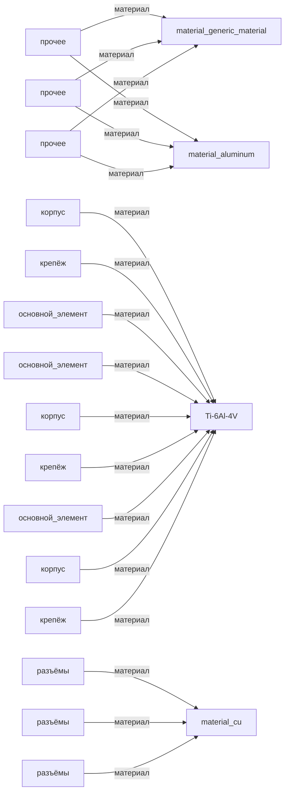

# Граф 1 — подсистема «система_охлаждения»

| Материал | Используется в частях |
|---|---:|
| `Ti-6Al-4V` | 9 |
| `material_generic_material` | 3 |
| `material_aluminum` | 3 |
| `material_cu` | 3 |
