# Граф 3 — прослеживаемость требований

```mermaid
graph LR
    F70([F70])
    script__helpers_py[_helpers.py]
    F70 --> script__helpers_py
    script_pre-commit-hook_py[pre-commit-hook.py]
    F70 --> script_pre-commit-hook_py
    script_validate_decomposition_py[validate_decomposition.py]
    F70 --> script_validate_decomposition_py
    script_validate_field_contracts_py[validate_field_contracts.py]
    F70 --> script_validate_field_contracts_py
    F25([F25])
    script_pre-commit-hook_py[pre-commit-hook.py]
    F25 --> script_pre-commit-hook_py
    script_real_decomposition_py[real_decomposition.py]
    F25 --> script_real_decomposition_py
    script_validate_decomposition_py[validate_decomposition.py]
    F25 --> script_validate_decomposition_py
    script_web_verify_py[web_verify.py]
    F25 --> script_web_verify_py
    F86([F86])
    script__helpers_py[_helpers.py]
    F86 --> script__helpers_py
    script_check_model_completeness_py[check_model_completeness.py]
    F86 --> script_check_model_completeness_py
    script_pre-commit-hook_py[pre-commit-hook.py]
    F86 --> script_pre-commit-hook_py
    F13([F13])
    script_generate_decomposition_py[generate_decomposition.py]
    F13 --> script_generate_decomposition_py
    script_pre-commit-hook_py[pre-commit-hook.py]
    F13 --> script_pre-commit-hook_py
    script_validate_decomposition_py[validate_decomposition.py]
    F13 --> script_validate_decomposition_py
    F14([F14])
    script_generate_decomposition_py[generate_decomposition.py]
    F14 --> script_generate_decomposition_py
    script_generate_wrapper_izdeliya_py[generate_wrapper_izdeliya.py]
    F14 --> script_generate_wrapper_izdeliya_py
    script_validate_decomposition_py[validate_decomposition.py]
    F14 --> script_validate_decomposition_py
    F16([F16])
    script_generate_decomposition_py[generate_decomposition.py]
    F16 --> script_generate_decomposition_py
    script_generate_wrapper_izdeliya_py[generate_wrapper_izdeliya.py]
    F16 --> script_generate_wrapper_izdeliya_py
    script_validate_decomposition_py[validate_decomposition.py]
    F16 --> script_validate_decomposition_py
    F19([F19])
    script_generate_decomposition_py[generate_decomposition.py]
    F19 --> script_generate_decomposition_py
    script_generate_wrapper_izdeliya_py[generate_wrapper_izdeliya.py]
    F19 --> script_generate_wrapper_izdeliya_py
    script_validate_decomposition_py[validate_decomposition.py]
    F19 --> script_validate_decomposition_py
    F22([F22])
    script_pre-commit-hook_py[pre-commit-hook.py]
    F22 --> script_pre-commit-hook_py
    script_validate_decomposition_py[validate_decomposition.py]
    F22 --> script_validate_decomposition_py
    script_web_verify_py[web_verify.py]
    F22 --> script_web_verify_py
    F23([F23])
    script_pre-commit-hook_py[pre-commit-hook.py]
    F23 --> script_pre-commit-hook_py
    script_validate_decomposition_py[validate_decomposition.py]
    F23 --> script_validate_decomposition_py
    script_web_verify_py[web_verify.py]
    F23 --> script_web_verify_py
    F27([F27])
    script_pre-commit-hook_py[pre-commit-hook.py]
    F27 --> script_pre-commit-hook_py
    script_validate_decomposition_py[validate_decomposition.py]
    F27 --> script_validate_decomposition_py
    script_web_verify_py[web_verify.py]
    F27 --> script_web_verify_py
    F70g([F70g])
    script__helpers_py[_helpers.py]
    F70g --> script__helpers_py
    script_pre-commit-hook_py[pre-commit-hook.py]
    F70g --> script_pre-commit-hook_py
    F70h([F70h])
    script__helpers_py[_helpers.py]
    F70h --> script__helpers_py
    script_pre-commit-hook_py[pre-commit-hook.py]
    F70h --> script_pre-commit-hook_py
    F81([F81])
    script__helpers_py[_helpers.py]
    F81 --> script__helpers_py
    script_pre-commit-hook_py[pre-commit-hook.py]
    F81 --> script_pre-commit-hook_py
    F83([F83])
    script__helpers_py[_helpers.py]
    F83 --> script__helpers_py
    script_pre-commit-hook_py[pre-commit-hook.py]
    F83 --> script_pre-commit-hook_py
    F87([F87])
    script__helpers_py[_helpers.py]
    F87 --> script__helpers_py
    script_pre-commit-hook_py[pre-commit-hook.py]
    F87 --> script_pre-commit-hook_py
    F88([F88])
    script__helpers_py[_helpers.py]
    F88 --> script__helpers_py
    script_pre-commit-hook_py[pre-commit-hook.py]
    F88 --> script_pre-commit-hook_py
    F3([F3])
    script_classify_subsystem_py[classify_subsystem.py]
    F3 --> script_classify_subsystem_py
    script_pre-commit-hook_py[pre-commit-hook.py]
    F3 --> script_pre-commit-hook_py
    F17([F17])
    script_generate_decomposition_py[generate_decomposition.py]
    F17 --> script_generate_decomposition_py
    script_validate_decomposition_py[validate_decomposition.py]
    F17 --> script_validate_decomposition_py
    F21([F21])
    script_generate_decomposition_py[generate_decomposition.py]
    F21 --> script_generate_decomposition_py
    script_validate_decomposition_py[validate_decomposition.py]
    F21 --> script_validate_decomposition_py
    F24([F24])
    script_pre-commit-hook_py[pre-commit-hook.py]
    F24 --> script_pre-commit-hook_py
    script_validate_decomposition_py[validate_decomposition.py]
    F24 --> script_validate_decomposition_py
```

_Показаны топ-20 метрик по числу скриптов-валидаторов (из 68 метрик)._

| Метрика | Скрипты-валидаторы | Контракты |
|---|---|---|
| `F13` | generate_decomposition.py, pre-commit-hook.py, validate_decomposition.py | — |
| `F14` | generate_decomposition.py, generate_wrapper_izdeliya.py, validate_decomposition.py | — |
| `F15` | generate_decomposition.py | — |
| `F16` | generate_decomposition.py, generate_wrapper_izdeliya.py, validate_decomposition.py | — |
| `F17` | generate_decomposition.py, validate_decomposition.py | — |
| `F18` | validate_decomposition.py | — |
| `F19` | generate_decomposition.py, generate_wrapper_izdeliya.py, validate_decomposition.py | — |
| `F20` | validate_decomposition.py | — |
| `F21` | generate_decomposition.py, validate_decomposition.py | — |
| `F22` | pre-commit-hook.py, validate_decomposition.py, web_verify.py | — |
| `F23` | pre-commit-hook.py, validate_decomposition.py, web_verify.py | — |
| `F24` | pre-commit-hook.py, validate_decomposition.py | — |
| `F25` | pre-commit-hook.py, real_decomposition.py, validate_decomposition.py, web_verify.py | — |
| `F26` | pre-commit-hook.py, validate_decomposition.py | — |
| `F27` | pre-commit-hook.py, validate_decomposition.py, web_verify.py | — |
| `F28` | pre-commit-hook.py, validate_decomposition.py | — |
| `F3` | classify_subsystem.py, pre-commit-hook.py | fc_изделие_подсистема, fc_модель_тип |
| `F36` | generate_graphs.py, pre-commit-hook.py | — |
| `F37` | generate_graphs.py, pipeline.py | — |
| `F38` | generate_graphs.py, pipeline.py | — |
| `F39` | pipeline.py | — |
| `F4` | pre-commit-hook.py | — |
| `F40` | pipeline.py | — |
| `F46` | pipeline.py | — |
| `F47` | pipeline.py | — |
| `F5` | pre-commit-hook.py | — |
| `F51` | _stubs.py | — |
| `F52` | _stubs.py | — |
| `F53` | _stubs.py | — |
| `F54` | _stubs.py | — |
| `F55` | _stubs.py | — |
| `F56` | validate_field_contracts.py | fc_изделие_масса, fc_изделие_стандарты, fc_материал_кристалл_структура, fc_материал_оптимальная_структура, fc_материал_предел_текучести, fc_реализация_покрытие_функций |
| `F57` | _stubs.py | — |
| `F58` | validate_field_contracts.py | fc_изделие_масса, fc_изделие_стандарты, fc_материал_кристалл_структура, fc_материал_оптимальная_структура, fc_материал_предел_текучести, fc_реализация_покрытие_функций |
| `F59` | validate_field_contracts.py | fc_изделие_масса, fc_изделие_стандарты, fc_материал_кристалл_структура, fc_материал_оптимальная_структура, fc_материал_предел_текучести, fc_реализация_покрытие_функций |
| `F60` | validate_field_contracts.py | fc_изделие_масса, fc_изделие_стандарты, fc_материал_кристалл_структура, fc_материал_оптимальная_структура, fc_материал_предел_текучести, fc_реализация_покрытие_функций |
| `F67` | _stubs.py | — |
| `F68` | _stubs.py | — |
| `F70` | _helpers.py, pre-commit-hook.py, validate_decomposition.py, validate_field_contracts.py | fc_изделие_масса, fc_изделие_стандарты, fc_материал_кристалл_структура, fc_материал_оптимальная_структура, fc_материал_предел_текучести, fc_реализация_покрытие_функций |
| `F70a` | _helpers.py | — |
| `F70b` | _helpers.py | — |
| `F70c` | _helpers.py | — |
| `F70d` | _helpers.py | — |
| `F70e` | _helpers.py | — |
| `F70f` | _helpers.py | — |
| `F70g` | _helpers.py, pre-commit-hook.py | — |
| `F70h` | _helpers.py, pre-commit-hook.py | — |
| `F70i` | _helpers.py | — |
| `F70j` | _helpers.py | — |
| `F71` | _helpers.py | — |
| `F72` | _helpers.py | — |
| `F73` | _helpers.py | — |
| `F74` | _helpers.py | — |
| `F75` | _helpers.py, classify_subsystem.py | fc_изделие_подсистема, fc_модель_тип |
| `F79` | _helpers.py | — |
| `F8` | pre-commit-hook.py | — |
| `F80` | _helpers.py | — |
| `F81` | _helpers.py, pre-commit-hook.py | — |
| `F82` | pre-commit-hook.py | — |
| `F83` | _helpers.py, pre-commit-hook.py | — |
| `F84` | pre-commit-hook.py | — |
| `F85` | pre-commit-hook.py | — |
| `F86` | _helpers.py, check_model_completeness.py, pre-commit-hook.py | — |
| `F87` | _helpers.py, pre-commit-hook.py | — |
| `F88` | _helpers.py, pre-commit-hook.py | — |
| `F89` | _helpers.py | — |
| `F90` | _helpers.py | — |
| `P012` | pipeline.py | — |
