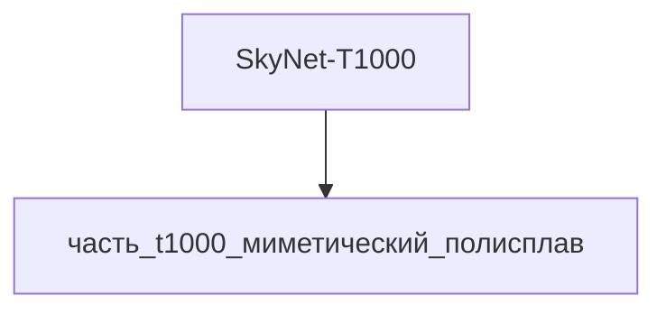

---

id: izdelie_SkyNet-T1000
тип: изделие
категория: машиностроение
уровень_иерархии: верхний
уровень_номер: 1
подсистема: вычислительная
подтип: прочее
стандарты: []
исследовательская_группа: skynet
родитель: null
дочерние_части:
  - часть_t1000_миметический_полисплав
материалы_частей:
  - часть: часть_t1000_миметический_полисплав
    материал: mimetic_polyalloy
    форма: миметические_оболочки
    доля_массы: 1.0
технологии_частей:
  - часть: часть_t1000_миметический_полисплав
    технология: tekhnologia_lite_pod_davleniem
    доля_использования: 1.0
    материалы_для_процесса:
      - материал: gallinstan
        роль: обрабатываемый
наследуемые_материалы:
  - материал: mimetic_polyalloy
    суммарная_доля_массы: 1.0
    источники_частей:
      - часть_t1000_миметический_полисплав

scaling_type: количественный
соединители: []
версия: ии-улучшенная
статус_реальности: real
доступность: ии_проект
статус: извлечено
ии_перепроектирован:
  статус: true
  верификация: []
основные:
  масса_kg: null
наследуемые: {}
дополнительные:
  соответствующая_модель: SkyNet-T1000
  канон_источник: 'фантастические данные/модели/t1000.md'
дата_создания: 2026-11-03
дата_обновления: 2026-11-10
источник: web_search
источник_url: https://terminator.fandom.com/wiki/T-1000
источник_дата: 2026-11-06
источник_разбора: канон
---

# Изделие-обёртка: SkyNet-T1000

## Описание

Wrapper-изделие для модели `SkyNet-T1000` (тип: жидкий_металл, подсистема: вычислительная).

Канон: T-1000 Advanced Prototype (1000 Series) — жидкометаллический терминатор Skynet (2029) из фильма «Terminator 2: Judgment Day» (1991), в исполнении Robert Patrick; первый терминатор без эндоскелета — целиком состоит из жидкого металла (mimetic polyalloy) и полностью автономен. Морфирует в любую форму сходного объёма, которого касается (ограничения: объекты меньшего объёма и механизмы с движущимися частями невозможны), вооружение — только примитивное гранёное/колющее (крюки, ножи); мозг — распределённый жидкомолекулярный (hivemind миллиардов наночастиц), модель обладает самоосознанием и потому снята с производства самим Skynet. Скорость преследования ≥40 mph (~64 км/ч), масса модели по канону 120 кг. Изделие представляет вычислительную подсистему целиком из миметического полисплава (`mimetic_polyalloy`).

Создано для поддержки декомпозиции: дочерние части (часть_*) ссылаются на
этот id как на родителя. Сама модель остаётся в фантастические данные/модели/.

## Декомпозиция

## Состав

Дочерние части:
- `часть_t1000_миметический_полисплав`

## Связанная модель

- [`SkyNet-T1000`](../../../../фантастические%20данные/модели/t1000) — модель SkyNet

## Источники

- Wrapper-изделие создано автоматически (2026-11-03) для поддержки декомпозиции
- [T-1000 | Terminator Wiki — Fandom](https://terminator.fandom.com/wiki/T-1000) — Advanced Prototype, 2029, mimetic polyalloy, ≥40 mph, molecular brain (проверено 2026-11-06)
- [T-1000 — Wikipedia](https://en.wikipedia.org/wiki/T-1000) — T2 (1991), Robert Patrick, жидкий металл, T-X/T-1001/Rev-9 наследуют возможности (проверено 2026-11-06)
