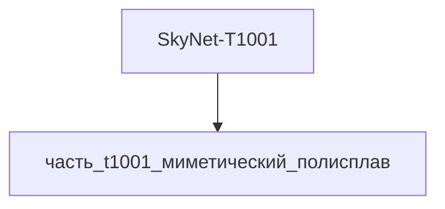

---

id: izdelie_SkyNet-T1001
тип: изделие
категория: машиностроение
уровень_иерархии: верхний
уровень_номер: 1
подсистема: вычислительная
подтип: прочее
стандарты: []
исследовательская_группа: skynet
родитель: null
дочерние_части:
  - часть_t1001_миметический_полисплав
материалы_частей:
  - часть: часть_t1001_миметический_полисплав
    материал: mimetic_polyalloy
    доля_массы: 1.0

scaling_type: количественный
соединители: []
версия: ии-улучшенная
статус_реальности: real
доступность: ии_проект
статус: извлечено
ии_перепроектирован:
  статус: true
  верификация: []
основные:
  масса_kg: null
наследуемые: {}
дополнительные:
  соответствующая_модель: SkyNet-T1001
  канон_источник: 'фантастические данные/модели/t1001.md'
дата_создания: 2026-11-03
дата_обновления: 2026-11-06
источник: web_search
источник_url: https://terminator.fandom.com/wiki/Catherine_Weaver
источник_дата: 2026-11-06
источник_разбора: канон
---

# Изделие-обёртка: SkyNet-T1001

## Описание

Wrapper-изделие для модели `SkyNet-T1001` (тип: жидкий_металл, подсистема: вычислительная).

Канон: T-1001 — жидкометаллический терминатор из сериала «Terminator: The Sarah Connor Chronicles» (Fox, 2008–2009), известный по личности Catherine Weaver (Shirley Manson): тот же класс mimetic polyalloy, что и T-1000, копирует людей и предметы без подвижных частей (руки — в лезвия), в сериале занимает место CEO ZeiraCorp и развивает ИИ John Henry. Изделие представляет вычислительную подсистему целиком из миметического полисплава (`mimetic_polyalloy`).

Создано для поддержки декомпозиции: дочерние части (часть_*) ссылаются на
этот id как на родителя. Сама модель остаётся в фантастические данные/модели/.

## Декомпозиция

## Состав

Дочерние части:
- `часть_t1001_миметический_полисплав`

## Связанная модель

- [`SkyNet-T1001`](../../../../фантастические%20данные/модели/t1001) — модель SkyNet

## Источники

- Wrapper-изделие создано автоматически (2026-11-03) для поддержки декомпозиции
- [Catherine Weaver (T-1001) | Terminator Wiki — Fandom](https://terminator.fandom.com/wiki/Catherine_Weaver)
- [Catherine Weaver — Wikipedia](https://en.wikipedia.org/wiki/Catherine_Weaver)
