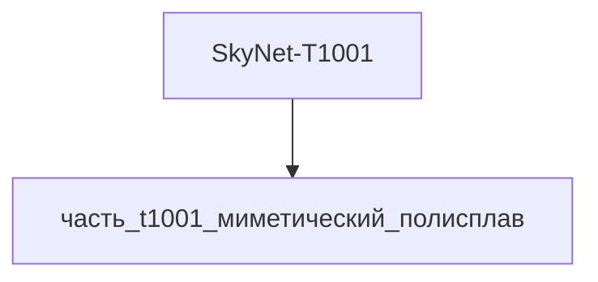

---

id: izdelie_SkyNet-T1001
тип: изделие
категория: машиностроение
уровень_иерархии: верхний
уровень_номер: 1
подсистема: вычислительная
подтип: прочее
стандарты: []
исследовательская_группа: skynet
родитель: null
дочерние_части:
  - часть_t1001_миметический_полисплав
материалы_частей:
  - часть: часть_t1001_миметический_полисплав
    материал: mimetic_polyalloy
    форма: миметические_оболочки
    доля_массы: 1.0
технологии_частей:
  - часть: часть_t1001_миметический_полисплав
    технология: tekhnologia_lite_pod_davleniem
    доля_использования: 1.0
    материалы_для_процесса:
      - материал: gallinstan
        роль: обрабатываемый
наследуемые_материалы:
  - материал: mimetic_polyalloy
    суммарная_доля_массы: 1.0
    источники_частей:
      - часть_t1001_миметический_полисплав

масштабируемость:
  режим: фиксированная
  параметры: [масса_kg]
  пределы:
    min: {масса_kg: 130}
    max: {масса_kg: 130}
  закон_масштабирования: 'canon: T-1001 — единственный известный экземпляр (Catherine Weaver, T:SCC 2008–2009), серийное производство не предусмотрено; масса 130 кг = объём миметического полисплава при плотности ~7000 кг/м³; изменение габарита = переплавка всего объёма тела'
  ограничивающие_части:
    - часть: часть_t1001_миметический_полисплав
      причина: 'единственная часть (100% массы): объём/масса полисплава целиком определяют габарит и массу изделия; реальный аналог gallinstan ограничен плотностью 6440 кг/м³ и рабочим диапазоном -19..+1300°C'
scaling_type: количественный
соединители: []
предок: material_gallinstan
предок_путь: реальные данные/материалы/gallinstan.md
улучшения:
  - тип: замена_материала
    что: 'mimetic polyalloy (canon-фантастика, не существует) → gallinstan (Ga-In-Sn эвтектика, real liquid metal): цельножидкометаллическая конструкция тела реализуема частично — реконфигурация формы течением, но не произвольный морфинг'
    причина: 'canon-полисплав физически не существует; gallinstan — единственный каталогизированный real-аналог класса «жидкий металл»: плавление -19°C (не застывает при комнатной температуре), плотность 6440 кг/м³, k=16.5 Вт/(м·К), нет испарения (p_vap < 1e-8 Торр при 500°C)'
    источник: 'https://en.wikipedia.org/wiki/Galinstan; https://terminator.fandom.com/wiki/Catherine_Weaver (обращение 2026-11-10); работа и и/изделия/вычислительная/t1001/часть_t1001_миметический_полисплав/_index.md (ссылка «реальный аналог: gallinstan.md»)'
    эффект_масса: 'canon 130 кг при ~7000 кг/м³ → 130 кг при 6440 кг/м³: масса сохранена, объём тела +8.7%'
    эффект_ресурс: 'canon: полисплав вечен (регенерация) → gallinstan: без коррозии и испарения в замкнутом контуре, ресурс ограничен механической оболочкой'
  - тип: замена_параметра
    что: 'рабочая температурная вилка: canon -196..+1500°C → gallinstan -19..+1300°C (жидкое состояние эвтектики)'
    причина: 'canon-уязвимости T-1001 (фантастические данные/модели/t1001.md: жидкий азот -196°C — замерзает и крошится, расплавленная сталь ~1500°C — уничтожение) сохраняются физически: LN2 (-196°C) замораживает gallinstan (твёрдая фаза, потеря морфинга); расплавленная сталь (+1500°C) выше кипения Ga-In-Sn — уничтожение'
    источник: 'https://en.wikipedia.org/wiki/Galinstan (эвтектика Ga-In-Sn плавится при -19°C); https://terminator.fandom.com/wiki/Catherine_Weaver; https://en.wikipedia.org/wiki/Catherine_Weaver'
    эффект_масса: 'не меняется (130 кг)'
    эффект_ресурс: 'диапазон эксплуатации сужен: при T < -19°C конструкция теряет жидкометаллические свойства (canon-совместимо)'
real_check:
  статус: требует_проверки
  метод: 'canon-спецификации T-1001 (Catherine Weaver, T:SCC, Wikipedia + Terminator Wiki, обращение 2026-11-10): mimetic polyalloy, шейпшифтинг, liquid metal CPU; real-аналог gallinstan верифицирован по Wikipedia (плавление -19°C, плотность 6440 кг/м³, k=16.5 Вт/(м·К), p_vap < 1e-8 Торр); произвольный морфинг физически не реализуем — помечен как canon-декларация'
  физические_пределы_соблюдены:
    - 'Плотность gallinstan 6440 кг/м³ < canon ~7000 кг/м³: масса 130 кг сохраняется при объёме тела +8.7%'
    - 'Уязвимость к -196°C (LN2) совпадает с canon T-1001: gallinstan кристаллизуется и теряет текучесть'
    - 'Расплавленная сталь/магма +1500°C выше рабочего диапазона Ga-In-Sn: canon-сценарий уничтожения физически воспроизводим'
    - 'Жидкий молекулярный CPU (вычислительная подсистема) — canon-декларация: реальный аналог отсутствует, real_check помечает как требует_проверки'
версия: ии-улучшенная
статус_реальности: real
доступность: ии_проект
статус: извлечено
ии_перепроектирован:
  статус: true
  верификация: []
основные:
  масса_kg: null
наследуемые: {}
дополнительные:
  соответствующая_модель: SkyNet-T1001
  канон_источник: 'фантастические данные/модели/t1001.md'
дата_создания: 2026-11-03
дата_обновления: 2026-11-10
источник: web_search
источник_url: https://terminator.fandom.com/wiki/Catherine_Weaver
источник_дата: 2026-11-06
источник_разбора: канон
---

# Изделие-обёртка: SkyNet-T1001

## Описание

Wrapper-изделие для модели `SkyNet-T1001` (тип: жидкий_металл, подсистема: вычислительная).

Канон: T-1001 — жидкометаллический терминатор из сериала «Terminator: The Sarah Connor Chronicles» (Fox, 2008–2009), известный по личности Catherine Weaver (Shirley Manson): тот же класс mimetic polyalloy, что и T-1000, копирует людей и предметы без подвижных частей (руки — в лезвия), в сериале занимает место CEO ZeiraCorp и развивает ИИ John Henry. Изделие представляет вычислительную подсистему целиком из миметического полисплава (`mimetic_polyalloy`).

Создано для поддержки декомпозиции: дочерние части (часть_*) ссылаются на
этот id как на родителя. Сама модель остаётся в фантастические данные/модели/.

## Декомпозиция

## Состав

Дочерние части:
- `часть_t1001_миметический_полисплав`

## Связанная модель

- [`SkyNet-T1001`](../../../../фантастические%20данные/модели/t1001) — модель SkyNet

## Источники

- Wrapper-изделие создано автоматически (2026-11-03) для поддержки декомпозиции
- [Catherine Weaver (T-1001) | Terminator Wiki — Fandom](https://terminator.fandom.com/wiki/Catherine_Weaver)
- [Catherine Weaver — Wikipedia](https://en.wikipedia.org/wiki/Catherine_Weaver)
