---

id: izdelie_SkyNet-Cameron
тип: изделие
категория: машиностроение
уровень_иерархии: верхний
уровень_номер: 1
подсистема: каркас
подтип: прочее
стандарты: []
исследовательская_группа: skynet
родитель: null
дочерние_части:
  - часть_cameron_cpu
  - часть_cameron_эндоскелет
  - часть_cameron_топливная_ячейка_1
  - часть_cameron_топливная_ячейка_2
  - часть_cameron_рука_левая
  - часть_cameron_нога_левая
  - часть_cameron_сенсоры
  - часть_cameron_ткань_кожа
материалы_частей:
  - часть: часть_cameron_эндоскелет
    материал: titanium_alloy
    доля_массы: 0.4842
  - часть: часть_cameron_ткань_кожа
    материал: living_tissue_clone
    доля_массы: 0.031

scaling_type: количественный
соединители: []
версия: ии-улучшенная
статус_реальности: real
доступность: ии_проект
статус: извлечено
ии_перепроектирован:
  статус: true
  верификация: []
основные:
  масса_kg: null
наследуемые: {}
дополнительные:
  соответствующая_модель: SkyNet-Cameron
  канон_источник: 'фантастические данные/модели/cameron_phillips.md'
дата_создания: 2026-11-03
дата_обновления: 2026-11-07
источник: web_search
источник_url: https://terminator.fandom.com/wiki/Cameron
источник_дата: 2026-11-07
источник_разбора: канон
---

# Изделие-обёртка: SkyNet-Cameron

## Описание

Wrapper-изделие для модели `SkyNet-Cameron` (тип: гуманоидный, подсистема: каркас).

Создано для поддержки декомпозиции: дочерние части (часть_*) ссылаются на
этот id как на родителя. Сама модель остаётся в фантастические данные/модели/.

## Декомпозиция

```mermaid
graph TD
    Cameron["SkyNet-Cameron"]
    cameron_cpu["часть_cameron_cpu"]
    Cameron --> cameron_cpu
    cameron_эндоскелет["часть_cameron_эндоскелет"]
    Cameron --> cameron_эндоскелет
    cameron_топливная_ячейка_["часть_cameron_топливная_ячейка_1"]
    Cameron --> cameron_топливная_ячейка_
    cameron_топливная_ячейка_["часть_cameron_топливная_ячейка_2"]
    Cameron --> cameron_топливная_ячейка_
    cameron_рука_левая["часть_cameron_рука_левая"]
    Cameron --> cameron_рука_левая
    Cameron --> cameron_рука_правая
    cameron_нога_левая["часть_cameron_нога_левая"]
    Cameron --> cameron_нога_левая
    Cameron --> cameron_нога_правая
    cameron_сенсоры["часть_cameron_сенсоры"]
    Cameron --> cameron_сенсоры
    cameron_ткань_кожа["часть_cameron_ткань_кожа"]
    Cameron --> cameron_ткань_кожа
```

## Состав

Дочерние части:
- `часть_cameron_cpu`
- `часть_cameron_эндоскелет`
- `часть_cameron_топливная_ячейка_1`
- `часть_cameron_топливная_ячейка_2`
- `часть_cameron_рука_левая`
- `часть_cameron_нога_левая`
- `часть_cameron_сенсоры`
- `часть_cameron_ткань_кожа`

## Связанная модель

- [`SkyNet-Cameron`](../../../../фантастические%20данные/модели/cameron_phillips) — модель SkyNet

## Источники

- Wrapper-изделие создано автоматически (2026-11-03) для поддержки декомпозиции
