---

id: izdelie_SkyNet-HKAerial
тип: изделие
категория: машиностроение
уровень_иерархии: верхний
уровень_номер: 1
подсистема: каркас
подтип: прочее
стандарты: []
исследовательская_группа: skynet
родитель: null
дочерние_части:
  - часть_hk_aerial_фюзеляж
  - часть_hk_aerial_двигатель_левый
  - часть_hk_aerial_сенсоры
  - часть_hk_aerial_плазма_пушка
  - часть_hk_aerial_навигация
  - часть_hk_aerial_связь
  - часть_hk_aerial_крылья
материалы_частей:
  - часть: часть_hk_aerial_фюзеляж
    материал: titanium_alloy
    доля_массы: 0.4
  - часть: часть_hk_aerial_двигатель_левый
    материал: inconel_718
    доля_массы: 0.1596
  - часть: часть_hk_aerial_плазма_пушка
    материал: tungsten_alloy
    доля_массы: 0.0469

scaling_type: количественный
соединители: []
версия: ии-улучшенная
статус_реальности: real
доступность: ии_проект
статус: извлечено
ии_перепроектирован:
  статус: true
  верификация: []
основные:
  масса_kg: null
наследуемые: {}
дополнительные:
  соответствующая_модель: SkyNet-HKAerial
  канон_источник: 'фантастические данные/модели/hk_aerial.md'
дата_создания: 2026-11-03
дата_обновления: 2026-11-05
источник: web_search
источник_разбора: канон
---

# Изделие-обёртка: SkyNet-HKAerial

## Описание

Wrapper-изделие для модели `SkyNet-HKAerial` (тип: воздушный, подсистема: каркас).

Создано для поддержки декомпозиции: дочерние части (часть_*) ссылаются на
этот id как на родителя. Сама модель остаётся в фантастические данные/модели/.

## Декомпозиция

```mermaid
graph TD
    HKAerial["SkyNet-HKAerial"]
    hk_aerial_фюзеляж["часть_hk_aerial_фюзеляж"]
    HKAerial --> hk_aerial_фюзеляж
    hk_aerial_двигатель_левый["часть_hk_aerial_двигатель_левый"]
    HKAerial --> hk_aerial_двигатель_левый
    HKAerial --> hk_aerial_двигатель_правы
    hk_aerial_сенсоры["часть_hk_aerial_сенсоры"]
    HKAerial --> hk_aerial_сенсоры
    hk_aerial_плазма_пушка["часть_hk_aerial_плазма_пушка"]
    HKAerial --> hk_aerial_плазма_пушка
    hk_aerial_навигация["часть_hk_aerial_навигация"]
    HKAerial --> hk_aerial_навигация
    hk_aerial_связь["часть_hk_aerial_связь"]
    HKAerial --> hk_aerial_связь
    hk_aerial_крылья["часть_hk_aerial_крылья"]
    HKAerial --> hk_aerial_крылья
```

## Состав

Дочерние части:
- `часть_hk_aerial_фюзеляж`
- `часть_hk_aerial_двигатель_левый`
- `часть_hk_aerial_сенсоры`
- `часть_hk_aerial_плазма_пушка`
- `часть_hk_aerial_навигация`
- `часть_hk_aerial_связь`
- `часть_hk_aerial_крылья`

## Связанная модель

- [`SkyNet-HKAerial`](../../../../фантастические%20данные/модели/hk_aerial) — модель SkyNet

## Источники

- Wrapper-изделие создано автоматически (2026-11-03) для поддержки декомпозиции
