## Описание

Wrapper-изделие для модели `SkyNet-HKTank` (тип: наземный_гусеничный, подсистема: каркас).

Создано для поддержки декомпозиции: дочерние части (часть_*) ссылаются на
этот id как на родителя. Сама модель остаётся в фантастические данные/модели/.

## Технические характеристики

| Параметр | Значение | Единица | Источник |
|---|---|---|---|
| подсистема | каркас | — | canon |
| подтип | прочее | — | canon |
| тип узла | изделие | — | canon |
| уровень_номер | 1 | — | canon |

## Состав

Дочерние части:
- `часть_hk_tank_корпус`
- `часть_hk_tank_гусеница_левая`
- `часть_hk_tank_башня`
- `часть_hk_tank_плазма_пушка_1`
- `часть_hk_tank_сенсоры`
- `часть_hk_tank_двигатель`
- `часть_hk_tank_связь`
- `часть_hk_tank_навигация`
- `часть_hk_tank_боеприпасы`

## Используемые технологии

- `tekhnologia_shtampovka_listovaya` (доля: 1.0)
- `tekhnologia_goryachaya_shtampovka` (доля: 1.0)
- `tekhnologia_shtampovka_listovaya` (доля: 1.0)

## Используемые материалы

- `rolled_homogeneous_armor` (форма: плита_катаная_броневая) → [`rolled_homogeneous_armor`](../../../материалы/rolled_homogeneous_armor.md)
- `steel_track` (форма: трак_штампованный) → [`steel_track`](../../../материалы/steel_track.md)
- `rolled_homogeneous_armor` (форма: плита_катаная_броневая) → [`rolled_homogeneous_armor`](../../../материалы/rolled_homogeneous_armor.md)

## Источники

- Wrapper-изделие создано автоматически (2026-11-03) для поддержки декомпозиции

## Декомпозиция

```mermaid
graph TD
    izdelie_SkyNet_HKTank["izdelie_SkyNet-HKTank"]
    ______hk_tank_______["часть_hk_tank_корпус"]
    izdelie_SkyNet_HKTank --> ______hk_tank_______
    ______hk_tank_______________["часть_hk_tank_гусеница_левая"]
    izdelie_SkyNet_HKTank --> ______hk_tank_______________
    ______hk_tank______["часть_hk_tank_башня"]
    izdelie_SkyNet_HKTank --> ______hk_tank______
    ______hk_tank______________1["часть_hk_tank_плазма_пушка_1"]
    izdelie_SkyNet_HKTank --> ______hk_tank______________1
    ______hk_tank________["часть_hk_tank_сенсоры"]
    izdelie_SkyNet_HKTank --> ______hk_tank________
    ______hk_tank__________["часть_hk_tank_двигатель"]
    izdelie_SkyNet_HKTank --> ______hk_tank__________
    ______hk_tank______["часть_hk_tank_связь"]
    izdelie_SkyNet_HKTank --> ______hk_tank______
    ______hk_tank__________["часть_hk_tank_навигация"]
    izdelie_SkyNet_HKTank --> ______hk_tank__________
    ______hk_tank___________["часть_hk_tank_боеприпасы"]
    izdelie_SkyNet_HKTank --> ______hk_tank___________
```

## Связанная модель

- [`SkyNet-HKTank`](../../../../фантастические%20данные/модели/hk_tank) — модель SkyNet
