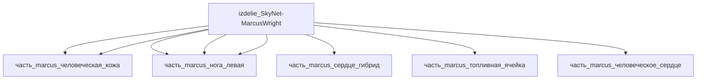

## Описание

Wrapper-изделие для модели `SkyNet-MarcusWright` (тип: гуманоидный, подсистема: каркас).

Создано для поддержки декомпозиции: дочерние части (часть_*) ссылаются на
этот id как на родителя. Сама модель остаётся в фантастические данные/модели/.

## Технические характеристики

| Параметр | Значение | Единица | Источник |
|---|---|---|---|
| подсистема | каркас | — | canon |
| подтип | прочее | — | canon |
| масса | 185.0 | kg | canon |
| тип узла | изделие | — | canon |
| уровень_номер | 1 | — | canon |

## Состав

Дочерние части:
- `часть_marcus_человеческий_мозг`
- `часть_marcus_эндоскелет`
- `часть_marcus_сердце_гибрид`
- `часть_marcus_топливная_ячейка`
- `часть_marcus_рука_левая`
- `часть_marcus_нога_левая`
- `часть_marcus_человеческое_сердце`
- `часть_marcus_человеческая_кожа`

## Используемые технологии

- `ebw` (доля: 1.0)
- `parylene_c` (доля: 1.0)

## Используемые материалы

- `ti-6al-4v` (форма: планер_и_космические_изделия) → [`ti-6al-4v`](../../../материалы/ti-6al-4v.md)
- `silicone-textile_composite` (форма: протезная_кожа_силиконовая) → [`silicone-textile_composite`](../../../материалы/silicone-textile_composite.md)

## Источники

- Wrapper-изделие создано автоматически (2026-11-03) для поддержки декомпозиции

## Декомпозиция

## Связанная модель

- [`SkyNet-MarcusWright`](../../../../фантастические%20данные/модели/marcus_wright) — модель SkyNet
