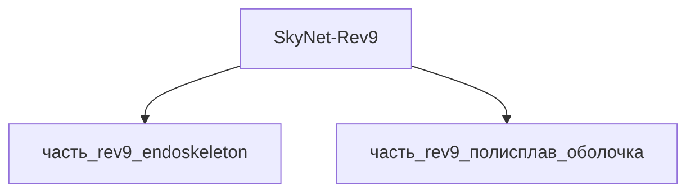

---

id: izdelie_SkyNet-Rev9
тип: изделие
категория: машиностроение
уровень_иерархии: верхний
уровень_номер: 1
подсистема: каркас
подтип: прочее
стандарты: []
исследовательская_группа: skynet
родитель: null
дочерние_части:
  - часть_rev9_endoskeleton
  - часть_rev9_полисплав_оболочка
материалы_частей:
  - часть: часть_rev9_endoskeleton
    материал: carbon_fiber_endoskeleton
    доля_массы: 0.5
  - часть: часть_rev9_полисплав_оболочка
    материал: mimetic_polyalloy
    доля_массы: 0.5

scaling_type: количественный
соединители: []
версия: ии-улучшенная
статус_реальности: real
доступность: ии_проект
статус: извлечено
ии_перепроектирован:
  статус: true
  верификация: []
основные:
  масса_kg: null
наследуемые: {}
дополнительные:
  соответствующая_модель: SkyNet-Rev9
  канон_источник: 'фантастические данные/модели/rev9.md'
дата_создания: 2026-11-03
дата_обновления: 2026-11-03
источник: web_search
источник_разбора: канон
---

# Изделие-обёртка: SkyNet-Rev9

## Описание

Wrapper-изделие для модели `SkyNet-Rev9` (тип: гуманоидный, подсистема: каркас).

Создано для поддержки декомпозиции: дочерние части (часть_*) ссылаются на
этот id как на родителя. Сама модель остаётся в фантастические данные/модели/.

## Декомпозиция

## Состав

Дочерние части:
- `часть_rev9_endoskeleton`
- `часть_rev9_полисплав_оболочка`

## Связанная модель

- [`SkyNet-Rev9`](../../../../фантастические%20данные/модели/rev9) — модель SkyNet

## Источники

- Wrapper-изделие создано автоматически (2026-11-03) для поддержки декомпозиции
