---

id: izdelie_SkyNet-T800
тип: изделие
категория: машиностроение
уровень_иерархии: верхний
уровень_номер: 1
подсистема: каркас
подтип: прочее
стандарты: []
исследовательская_группа: skynet
родитель: null
дочерние_части:
  - часть_t800_cpu
  - часть_t800_топливная_ячейка_1
  - часть_t800_эндоскелет_торс
  - часть_t800_рука_левая
  - часть_t800_нога_левая
  - часть_t800_оптический_сенсор_1
  - часть_t800_аудио_сенсор
  - часть_t800_антенна
  - часть_t800_гиро_навигация
  - часть_t800_ткань_кожа
материалы_частей:
  - часть: часть_t800_эндоскелет_торс
    материал: hyperalloy_t800
    доля_массы: 0.357
  - часть: часть_t800_cpu
    материал: silicon_neural_net
    доля_массы: 0.0024
  - часть: часть_t800_топливная_ячейка_1
    материал: lithium_hydrogen_cell
    доля_массы: 0.0720
  - часть: часть_t800_рука_левая
    материал: hyperalloy_t800
    доля_массы: 0.1204
  - часть: часть_t800_нога_левая
    материал: hyperalloy_t800
    доля_массы: 0.1806
  - часть: часть_t800_ткань_кожа
    материал: living_tissue_clone
    доля_массы: 0.129

scaling_type: количественный
соединители: []
версия: ии-улучшенная
статус_реальности: real
доступность: ии_проект
статус: извлечено
ии_перепроектирован:
  статус: true
  верификация: []
основные:
  масса_kg: 140
  максимальная_скорость_км_ч: 35
наследуемые: {}
дополнительные:
  соответствующая_модель: SkyNet-T800
  канон_источник: 'фантастические данные/модели/t800.md'
дата_создания: 2026-11-03
дата_обновления: 2026-11-06
источник: web_search
источник_url: https://terminator.fandom.com/wiki/T-800
источник_дата: 2026-11-06
источник_разбора: канон
---

# Изделие-обёртка: SkyNet-T800

## Описание

Массо-габаритный макет инфильтратора SkyNet-T800 (canon: The Terminator, 1984) —
первый киборг SkyNet: живая ткань поверх эндоскелета из hyperalloy. По канону
сериализован в 2026 г., производитель Cyberdyne Systems; 20% легче и на 40%
сильнее T-600. Питание — ядерная энергоячейка с ресурсом 120 лет непрерывной
работы; оптика с ИК-диапазоном, x15 зумом и 40 000-битным дисплеем.

Изделие-обёртка модели `SkyNet-T800` (гуманоидный, подсистема каркас):
дочерние части (часть_*) ссылаются на этот id как на родителя, сама модель
остаётся в фантастические данные/модели/. Ключевые материалы декомпозиции:
endoskeleton — hyperalloy_t800 (доля массы 0.357), CPU — silicon_neural_net,
питание — lithium_hydrogen_cell, кожа — living_tissue_clone.

Реальный аналог конструкционного сплава chassis — Tribaloy T-800
(Co-Mo-Cr-Si, Laves-фаза, износостойкость при высокой температуре;
stellite.com/tribaloy-t800).

## Декомпозиция

```mermaid
graph TD
    T800["SkyNet-T800"]
    t800_cpu["часть_t800_cpu"]
    T800 --> t800_cpu
    t800_топливная_ячейка_1["часть_t800_топливная_ячейка_1"]
    T800 --> t800_топливная_ячейка_1
    T800 --> t800_топливная_ячейка_2
    t800_эндоскелет_торс["часть_t800_эндоскелет_торс"]
    T800 --> t800_эндоскелет_торс
    t800_рука_левая["часть_t800_рука_левая"]
    T800 --> t800_рука_левая
    T800 --> t800_рука_правая
    t800_нога_левая["часть_t800_нога_левая"]
    T800 --> t800_нога_левая
    T800 --> t800_нога_правая
    t800_оптический_сенсор_1["часть_t800_оптический_сенсор_1"]
    T800 --> t800_оптический_сенсор_1
    T800 --> t800_оптический_сенсор_2
    t800_аудио_сенсор["часть_t800_аудио_сенсор"]
    T800 --> t800_аудио_сенсор
    t800_антенна["часть_t800_антенна"]
    T800 --> t800_антенна
    t800_гиро_навигация["часть_t800_гиро_навигация"]
    T800 --> t800_гиро_навигация
    t800_ткань_кожа["часть_t800_ткань_кожа"]
    T800 --> t800_ткань_кожа
```

## Состав

Дочерние части:
- `часть_t800_cpu`
- `часть_t800_топливная_ячейка_1`
- `часть_t800_эндоскелет_торс`
- `часть_t800_рука_левая`
- `часть_t800_нога_левая`
- `часть_t800_оптический_сенсор_1`
- `часть_t800_аудио_сенсор`
- `часть_t800_антенна`
- `часть_t800_гиро_навигация`
- `часть_t800_ткань_кожа`

## Связанная модель

- [`SkyNet-T800`](../../../../фантастические%20данные/модели/t800) — модель SkyNet

## Источники

- Wrapper-изделие создано автоматически (2026-11-03) для поддержки декомпозиции
- T-800 (canon-спецификации: hyperalloy-эндоскелет, ядерная ячейка 120 лет,
  Cyberdyne Systems, сериализация 2026, сенсорика) —
  https://terminator.fandom.com/wiki/T-800 (2026-11-06)
- Hyperalloy (материал эндоскелета) — https://terminator.fandom.com/wiki/Hyperalloy
- Tribaloy T-800 — реальный аналог сплава (Co-Mo-Cr-Si, Laves-фаза) —
  https://www.stellite.com/us/en/alloys/tribaloy/tribaloy-t800-alloy.html
