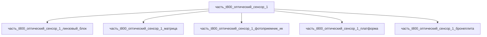

# Часть: часть_t800_оптический_сенсор_1 (×2)
## Описание

Оптический сенсор T-800: глазной модуль красной оптики с записью и ночным режимом; пара сенсоров защищена эндоскелетом черепа (canon T1/T2).

Конструкция модуля (декомпозиция 2026-11-09): юстированный кварцевый линзовый блок (окно + 2-линзовый объектив + ИК-фильтр, concussion-proof lenses) → монолитная КМОП/ПЗС матрица на кремниевой подложке (CCD/CMOS, расширенный видимый диапазон 380–750 нм) → SWIR-фотоприёмник InGaAsSb (ИК-канал 0.9–2.3 мкм, night_vision) с ТЭ-стабилизатором → гибкая электронная платформа с буфером записи (canon: запись) → вольфрамовая задняя бронеплита (реальный аналог canon hyperalloy по ударной защите, 50 % массы).

Родитель: `izdelie_SkyNet-T800` (подсистема: сенсоры).

## Технические характеристики

| Параметр | Значение | Единица | Источник |
|---|---|---|---|
| подсистема | сенсоры | — | canon |
| подтип | optical_camera | — | canon |
| масса | 0.2 | kg | canon |
| доля массы родителя | 0.0014 | — | canon |
| габариты (Д×Ш×В) | 30×30×20 | mm | canon |
| выработка энергии | 0.5 | W | canon |
| выработка тепла | 0.1 | W | canon |
| материалы (5 детей) | quartz/si/ingaassb/poliimid/tungsten (с формами) | — | декомпозиция СТРАТЕГИЯ B (2026-11-09); материалы: реальные данные/материалы/ |
| состав | 5 частей уровня 3: линзовый_блок, матрица_сенсора, фотоприемник_ик, платформа, бронеплита | — | декомпозиция СТРАТЕГИЯ B (web search 2026-11-09) |

## Принцип работы

CCD/CMOS sensor с extended visible frequencies (380-750nm) + infrared. Concussion-proof lenses.

Оптический канал: кварцевое окно и объектив линзового блока формируют изображение на КМОП/ПЗС матрице (видимый диапазон) и на SWIR-фотоприёмнике InGaAsSb (ИК-канал ночного режима); платформа микширует каналы и буферизует запись, поток уходит в нейроморфный CPU. Вольфрамовая бронеплита замыкает модуль с тыла, воспринимает ударную нагрузку и работает теплоёмким радиатором электронного стека.

## Тепловыделение

Баланс тепла сборки (F15b): Σ(детей) = 0.005 (линзовый_блок, поглощение излучения) + 0.06 (матрица, ohmic-рассеяние пикселей) + 0.02 (фотоприемник_ик, ТЭ-стабилизация) + 0.015 (платформа, контроллер/буфер) + 0 (бронеплита, пассивная) = 0.10 Вт = родитель 0.10 Вт → PASS.

Энергобюджет (canon 0.5 W): 0.01 + 0.35 + 0.07 + 0.07 + 0 = 0.50 Вт = родитель → PASS.

## Состав

Промежуточная часть (уровень 2), декомпозирована на 5 неделимых узлов уровня 3 (Σ масс 0.03+0.02+0.03+0.02+0.10 = 0.20 кг, доли 0.15+0.10+0.15+0.10+0.50 = 1.0):

- `часть_t800_оптический_сенсор_1_линзовый_блок` — юстированный герметичный оптический узел: кварцевое окно Ø26 + 2-линзовый объектив Ø24 + ИК-фильтр Ø20 в алюминиевой оправе с бронированным буртом (0.03 кг);
- `часть_t800_оптический_сенсор_1_матрица` — монолитная КМОП/ПЗС матрица на CZ-подложке si 12×12×0.5 в керамическом LGA-корпусе с медным теплоотводом (0.02 кг);
- `часть_t800_оптический_сенсор_1_фотоприемник_ик` — SWIR-фотодиод InGaAsSb (0.53 эВ ≈ 2.34 мкм) в TO-корпусе с ТЭ-стабилизатором bi2te3 (0.03 кг);
- `часть_t800_оптический_сенсор_1_платформа` — гибкая полиимидная платформа FPC 28×28 с контроллером, буфером записи и экранирующим кожухом (0.02 кг);
- `часть_t800_оптический_сенсор_1_бронеплита` — задняя вольфрамовая бронеплита 30×30×5 (ASTM B760) с посадочными втулками в глазнице (0.10 кг).

## Используемые материалы

- `quartz` (форма: оптика_и_техника_плавленого_кварца) → [`quartz.md`](../../../../../реальные%20данные/материалы/quartz.md)
- `si` (форма: подложки_ис_и_мэмс) → [`si.md`](../../../../../реальные%20данные/материалы/si.md)
- `ingaassb` (форма: mocvd_ingaassb_053ev) → [`ingaassb.md`](../../../../../реальные%20данные/материалы/ingaassb.md)
- `poliimid` (форма: подложка_fpc) → [`poliimid.md`](../../../../../реальные%20данные/материалы/poliimid.md)
- `tungsten` (форма: фольга_плита_ASTM_B760) → [`tungsten.md`](../../../../../реальные%20данные/материалы/tungsten.md)

## Источники

- Канон: декомпозиция `izdelie_SkyNet-T800` (web search 2026-11-03)
- [T-800 (Original timeline) | Terminator Wiki — Fandom](https://terminator.fandom.com/wiki/T-800)
- Benker M. et al. Room-Temperature Extended Short-Wave Infrared (e-SWIR) Avalanche Photodiodes — Micromachines 15(8):941, 2024: https://www.mdpi.com/2072-666X/15/8/941 (обращение 2026-11-09)
- High responsivity InGaAsSb p–n photodetector for extended SWIR detection: https://www.researchgate.net/publication/349171960_High_responsivity_InGaAsSb_p-n_photodetector_for_extended_SWIR_detection (обращение 2026-11-09)
- Материалы: реальные данные/материалы/

## Примечание о количестве

Эта часть представляет собой **2 идентичных экземпляра** (поле `количество: 2`).
для устранения дублирования данных (принцип P085 — канонизация).
Масса и габариты указаны за **один** экземпляр; `доля_массы_родителя` — суммарная.
