---

id: izdelie_SkyNet-TX
тип: изделие
категория: машиностроение
уровень_иерархии: верхний
уровень_номер: 1
подсистема: каркас
подтип: прочее
стандарты: []
исследовательская_группа: skynet
родитель: null
дочерние_части:
  - часть_t_x_cpu
  - часть_t_x_эндоскелет
  - часть_t_x_топливная_ячейка_1
  - часть_t_x_плазма_пушка
  - часть_t_x_нанотех_инъектор
  - часть_t_x_рука_левая
  - часть_t_x_нога_левая
  - часть_t_x_сенсоры
  - часть_t_x_ткань_кожа
материалы_частей:
  - часть: часть_t_x_эндоскелет
    материал: hyperalloy_tx
    доля_массы: 0.45
  - часть: часть_t_x_плазма_пушка
    материал: tungsten_alloy
    доля_массы: 0.07
  - часть: часть_t_x_ткань_кожа
    материал: living_tissue_clone
    доля_массы: 0.027

scaling_type: количественный
соединители: []
версия: ии-улучшенная
статус_реальности: real
доступность: ии_проект
статус: извлечено
ии_перепроектирован:
  статус: true
  верификация: []
основные:
  масса_kg: null
наследуемые: {}
дополнительные:
  соответствующая_модель: SkyNet-TX
  канон_источник: 'фантастические данные/модели/t_x.md'
дата_создания: 2026-11-03
дата_обновления: 2026-11-07
источник: web_search
источник_url: https://terminator.fandom.com/wiki/T-X
источник_дата: 2026-11-07
источник_разбора: канон
---

# Изделие-обёртка: SkyNet-TX

## Описание

Wrapper-изделие для модели `SkyNet-TX` (тип: гуманоидный, подсистема: каркас).

Создано для поддержки декомпозиции: дочерние части (часть_*) ссылаются на
этот id как на родителя. Сама модель остаётся в фантастические данные/модели/.

## Декомпозиция

```mermaid
graph TD
    TX["SkyNet-TX"]
    t_x_cpu["часть_t_x_cpu"]
    TX --> t_x_cpu
    t_x_эндоскелет["часть_t_x_эндоскелет"]
    TX --> t_x_эндоскелет
    t_x_топливная_ячейка_1["часть_t_x_топливная_ячейка_1"]
    TX --> t_x_топливная_ячейка_1
    TX --> t_x_топливная_ячейка_2
    t_x_плазма_пушка["часть_t_x_плазма_пушка"]
    TX --> t_x_плазма_пушка
    t_x_нанотех_инъектор["часть_t_x_нанотех_инъектор"]
    TX --> t_x_нанотех_инъектор
    t_x_рука_левая["часть_t_x_рука_левая"]
    TX --> t_x_рука_левая
    TX --> t_x_рука_правая
    t_x_нога_левая["часть_t_x_нога_левая"]
    TX --> t_x_нога_левая
    TX --> t_x_нога_правая
    t_x_сенсоры["часть_t_x_сенсоры"]
    TX --> t_x_сенсоры
    t_x_ткань_кожа["часть_t_x_ткань_кожа"]
    TX --> t_x_ткань_кожа
```

## Состав

Дочерние части:
- `часть_t_x_cpu`
- `часть_t_x_эндоскелет`
- `часть_t_x_топливная_ячейка_1`
- `часть_t_x_плазма_пушка`
- `часть_t_x_нанотех_инъектор`
- `часть_t_x_рука_левая`
- `часть_t_x_нога_левая`
- `часть_t_x_сенсоры`
- `часть_t_x_ткань_кожа`

## Связанная модель

- [`SkyNet-TX`](../../../../фантастические%20данные/модели/t_x) — модель SkyNet

## Источники

- Wrapper-изделие создано автоматически (2026-11-03) для поддержки декомпозиции
