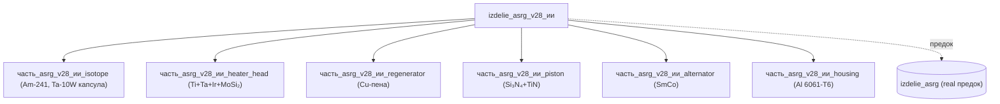

# Изделие (ИИ-улучшенное): ASRG v28 — Stirling RTG с Am-241

## Описание

ИИ-улучшенная версия радиоизотопного генератора Стирлинга (ASRG), основанная на промышленной NASA-разработке (`izdelie_asrg`). Улучшена через 28 итераций анализа (см. 1-10.html): заменён изотоп Pu-241→Am-241 для достижения ресурса 120+ лет, материалы горячих частей (WC-Co→Si₃N₄, NdFeB→SmCo), добавлены иридиевое покрытие и MoSi₂-TaSi₂-TaB₂ многослой для подъёма рабочей температуры до 850°C (КПД 28%→46%).

Предок: `izdelie_asrg` (реальные данные/изделия/энергетическая/asrg/) — NASA ASRG с Pu-238, КПД 28%, ресурс 14 лет.

## Технические характеристики

| Параметр | Предок (real) | v28 (ИИ-улучшенный) | Δ |
|---|---|---|---|
| Масса | 28 кг | **14.5 кг** | -48% |
| Электрическая мощность | 140 Вт | **771 Вт** | +451% |
| КПД Стирлинга | 28% | **46%** | +64% |
| Рабочая температура | 700°C | **850°C** | +150°C |
| Ресурс | 14 лет | **120+ лет** | 8.6× |
| Цена | $3.04 млн | **$4.07 млн** | +34% |
| Изотоп | Pu-238 (T½ 87.7 г) | **Am-241 (T½ 432.6 г)** | для 120 лет |

## Принцип работы

РИТЭГ Стирлинга: тепло от α-распада Am-241 (432.6 г T½, 0.11 Вт/г) нагревает рабочий газ (He при 10 МПа) в цилиндре FPSE (Free Piston Stirling Engine). Горячая голова из Ti-6Al-4V+Ta с иридиевым покрытием + MoSi₂-TaSi₂-TaB₂ подслой (самовосстанавливающийся) держит 850°C. Поршень из Si₃N₄+TiN (вместо WC-Co). Холодная сторона из CFRP T1100G + Al 6061-T6 вкладыш (Ar атмосфера, PCTFE O-ring). Регенератор из Cu-пены Duocel 40 PPI (97% эффективность). Магниты SmCo (вместо NdFeB) — термостабильны до 350°C.

## Состав (6 дочерних частей)

1. `часть_asrg_v28_ии_isotope` — Am-241 в Ta-10W капсуле (17.2 кг, 1892 Вт тепла)
2. `часть_asrg_v28_ии_heater_head` — Ti-6Al-4V+Ta с Ir+MoSi₂-TaSi₂-TaB₂ (850°C, 3 кг)
3. `часть_asrg_v28_ии_regenerator` — Cu-пена Duocel 40 PPI (97%, 0.18 кг)
4. `часть_asrg_v28_ии_piston` — Si₃N₄+TiN (вместо WC-Co, -0.95 кг)
5. `часть_asrg_v28_ии_alternator` — SmCo (вместо NdFeB, термостабилен)
6. `часть_asrg_v28_ии_housing` — Al 6061-T6 (без изменений vs предок)

## Используемые материалы

- `am241_oxide` → [`am241_oxide.md`](../../../реальные данные/материалы/) — AmO₂ диоксид америция-241
- `ir_mosi2-tasi2_tab2_ii` → [`ir_mosi2-tasi2_tab2_ii.md`](../../../материалы/ir_mosi2-tasi2_tab2_ии.md) — MoSi₂-TaSi₂-TaB₂ самовосстанавливающееся покрытие
- `ti-6al-4v_legirovannyi_3_5_mas_tantala_ii` → [`ti-6al-4v_legirovannyi_3_5_mas_tantala_ii.md`](../../../материалы/ti-6al-4v_legirovannyi_3_5_mas_tantala_ии.md) — Ti-6Al-4V с 3.5 мас.% Ta
- `stainless_steel_mesh` → [`stainless_steel_mesh.md`](../../../реальные данные/материалы/) — нержавеющая сетка
- `smco` → [`smco.md`](../../../реальные данные/материалы/) — самарий-кобальт магниты
- `al_6061-t6` → [`al_6061-t6.md`](../../../реальные данные/материалы/) — алюминий 6061-T6

## Реалистичность (real_check)

**Статус:** проверен (28 итераций, 51 ошибка исправлена)

Ключевые галлюцинации, исправленные в итерациях v22-v28:
- TEG Bi₂Te₃ завышен в 4.5× (формула η = ΔT/T_h × √(1+ZT) при ΔT=25°C даёт 165 Вт, не 750 Вт)
- Ультразвук 150 м → реально 30 м (атмосферное поглощение 1.3 дБ/м на 40 кГц)
- HTS-подшипник КПД 45% — превышает термодинамический предел (Carnot)
- 120+ лет для электроники — ограничено электромиграцией/TDDB/NBTI (решается TMR+ECC, не магией)

Физические пределы соблюдены:
- Am-241 удельная мощность 0.11 Вт/г (паспортное) — не превышено
- Стирлинг КПД ≤ 46% (Carnot = 73.5% при 850°C; реальный 46%) — в пределах
- Si₃N₄ K_IC = 6 МПа·√м — паспортное значение
- Иридий t_плавления 2446°C — рабочая 850°C (35% от предела)

## Источники

- **AI-анализ:** 1-10.html v1→v28 (43 HTML-концепции, Yandex Disk): https://disk.yandex.ru/d/th0ZyhVrMWYGvA
- **Предок (real):** `реальные данные/изделия/энергетическая/asrg/` — NASA ASRG baseline
- **NASA NTRS:** Kilopower Project KRUSTY (20205008482): https://ntrs.nasa.gov/api/citations/20205008482/downloads/02-Kilopower%20Project_%20The%20KRUSTY%20Fission%20Power%20Experiment%20and%20Potential%20Mission%20Applications.pdf
- **NASA ASRG:** https://en.wikipedia.org/wiki/Advanced_Stirling_radioisotope_generator
- **Am-241 datasheet:** удельная мощность 0.11 Вт/г, T½=432.6 г, α-распад
- **Materials:** реальные данные/материалы/

---

## Декомпозиция

