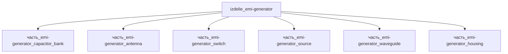

# Изделие: ЭМИ-генератор

## Описание

ЭМИ-генератор (EMP — электромагнитный импульс) — оружие поражения электроники

Полное наименование (как в CSV): `ЭМИ-генератор (EMP — электромагнитный импульс) — оружие поражения электроники`

## Технические характеристики

| Параметр | Значение | Единица | Источник |
|---|---|---|---|
| подсистема | энергетическая | — | classify_subsystem |
| категория | энергетика | — | classify_subsystem |
| габариты_mm (l×w×h) | 1200×800×1200 | мм | шкаф 19'' 800W×1200D×27U (EIA-310), upcom.com.tr |

(Параметры требуют уточнения через веб-поиск и вычислений; см. fc_изделие_масса, fc_изделие_стандарты в _field_contracts.yaml)

## Состав

Изделие верхнего уровня, 6 дочерних частей: capacitor_bank, antenna, switch, source, waveguide, housing — размещены в напольном шкафу 19'' 800×1200×1200 мм; V(шкафа)=1.152 м³ ≥ Σ V(детей)×1.15=1.079 м³ (упаковочный коэффициент 1.15 с зазорами на крепёж и кабельные каналы).

## Используемые технологии

(Ссылки на реальные_данные/технологии/ добавляются после связывания)

## Используемые материалы

(Ссылки на реальные_данные/материалы/ добавляются после связывания)

## Принцип работы

Требует описания на основе инженерного анализа.

## Источники

- CSV: `начальные данные_final.csv` (пользовательский ввод)

---

## Декомпозиция

