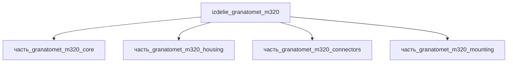

# Изделие: Гранатомёт M320

## Описание

M320 Grenade Launcher Module (GLM) — однозарядный 40×46mm SR навесной гранатомёт Heckler & Koch (производство H&K/Capco), заменивший M203 в ВС США с 2009 года. Модульная конструкция: устанавливается под ствол винтовок M4/M16 либо используется как самостоятельное оружие с выдвижным прикладом и встроенным красным точечным прицелом; существует версия с лазерным дальномером AN/PSQ-18A.

Полное наименование (как в CSV): `Гранатомёт M320`

## Технические характеристики

| Параметр | Значение | Источник |
|---|---|---|
| калибр | 40×46mm SR (LV) | Wikipedia M320 GLM |
| масса | 1.5 кг (infobox); 1.62 кг (базовая конфигурация); до 3.2 кг с прикладом/ПНВ | Wikipedia; обзор спецификаций 2024 |
| длина | 350 мм (ствол 280 мм) | Wikipedia |
| темп стрельбы | 5–7 выстр/мин | Warrior Lodge / SOFREP |
| начальная скорость гранаты | ~78 м/с (255 fps) | SOFREP |

## Состав

Изделие верхнего уровня. Дочерние части: `часть_granatomet_m320_core` (ствол/приёмник/УСМ), `часть_granatomet_m320_housing` (корпус с рукоятью), `часть_granatomet_m320_connectors` (разъёмы), `часть_granatomet_m320_mounting` (крепление).

## Используемые технологии

(Ссылки на реальные_данные/технологии/ добавляются после связывания)

## Используемые материалы

(Ссылки на реальные_данные/материалы/ добавляются после связывания)

## Принцип работы

Однозарядная схема с откидным стволом (перелом) и ударниковым УСМ двойного действия: граната 40×46mm SR подаётся вручную, пороховые газы метательного заряда разгоняют гранату до ~78 м/с; казённая часть запирается поворотом ствола относительно приёмника. Ручной/подствольный режимы реализуются съёмным прикладом и креплением на нижнюю планку винтовки.

## Источники

- CSV: `начальные данные_final.csv` (пользовательский ввод)

---

## Декомпозиция

