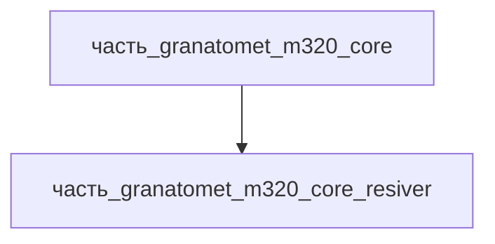

# Часть: часть_granatomet_m320_core_resiver

## Описание

Ствольная коробка (ресивер) M320/AG36: несущий корпус, в котором закреплена ось откидного ствола, замыкатель и ударный механизм. По SAR teardown ресивер выполнен преимущественно из высокопрочного алюминиевого сплава с твёрдым анодированием, со стальной вставкой вокруг отверстия бойка (износостойкость при наколе капсюля). Полимеры применены только в органах управления (Wikipedia AG36: «extensive use of polymers and high-strength aluminium»). Габариты 200×90×80 мм — часть длины 350 мм семейства AG36 (ствол+ресивер+УСМ). Масса 0.45 кг — оценка (несущий корпус с осью и замыкателем). Вторичный материал — сталь вставки бойка (spring_steel, A229) — включён в описание, в BOM принята алюминиевая основа.

Родитель: `часть_granatomet_m320_core` (подсистема: встроенное_оружие).

## Технические характеристики

| Параметр | Значение | Единица | Источник |
|---|---|---|---|
| подсистема | встроенное_оружие | — | canon |
| подтип | ресивер | — | canon |
| масса | 0.45 | kg | оценка: доля ствольной группы 1.2 кг (SAR/Wikipedia геометрия) |
| доля массы родителя | 0.375 | — | расчёт (0.45 / 1.2 кг core) |
| габариты (Д×Ш×В) | 200×90×80 | mm | AG36 350×90×210 (Wikipedia): доля по архитектуре break-action |
| выработка энергии | 0 | W | пассивная/механическая часть — генерации нет |
| выработка тепла | 0 | W | пассивный корпус — тепла не выделяет (нагрев от ствола — теплопередача) |
| материал | al_6061-t6 | — | SAR: «aircraft-grade aluminum» / «mostly aluminum alloy» → `al_6061-t6.md` |
| форма материала | корпуса_электроники | — | al_6061-t6: корпуса_электроники (варианты_по_применению) |

## Принцип работы

Ресивер воспринимает усилие запирания и отдачу при выстреле, несёт ось качания ствола, замыкатель с пружиной и корпус ударника. Стальная вставка вокруг отверстия бойка исключает смятие алюминия при наколе капсюля (SAR). Дробеструйное упрочнение (shot peening) поверхностей повышает усталостную долговечность алюминиевого корпуса при циклической стрельбе (MIL-STD-810). Тепла не выделяет (0 Вт) — нагрев от ствола снимается теплопередачей через посадочные поверхности.

## Состав

Атомарная часть (уровень 3, неделимый): закупочный/заводской узел, в полевых условиях не разбирается.

## Используемые материалы

- `al_6061-t6` → [`al_6061-t6.md`](../../../../../материалы/al_6061-t6.md) — корпуса_электроники
- `spring_steel` → [`spring_steel.md`](../../../../../материалы/spring_steel.md) — сталь вставки вокруг отверстия бойка (SAR), вторичный материал в тексте

## Источники

- Small Arms Review, «HK AG36 40x46mm Grenade Launcher» (2003): ресивер — aluminum alloy со стальной вставкой бойка; ствол — aircraft-grade aluminum — https://smallarmsreview.com/hk-ag36-40x46mm-grenade-launcher (обращение 2026-11-07)
- Wikipedia «M320 Grenade Launcher Module» (1.5 кг, ствол 280 мм, 76 м/с, 5–7 выстр/мин, 150/350/400 м) — https://en.wikipedia.org/wiki/M320_Grenade_Launcher_Module (обращение 2026-11-07)
- Канон: декомпозиция `часть_granatomet_m320_core` (F34, 2026-11-07)
- Материалы: реальные данные/материалы/

## Декомпозиция

