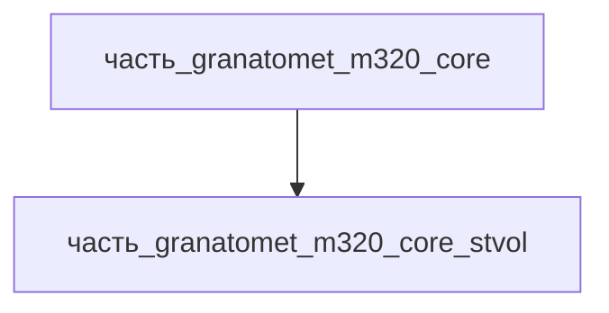

# Часть: часть_granatomet_m320_core_stvol

## Описание

Нарезной ствол 40×46 мм SR длиной 280 мм (11", Wikipedia M320) со ствольной коробкой казённика для break-action заряжания (ствол откидывается вбок, SAR teardown семейства AG36/M320). По SAR ствол выполнен из авиационного алюминиевого сплава с твёрдым анодированием; камора high-pressure соединяется вентилем (venturi) с низкодавленческой каморой вокруг гранаты — система high–low. Канал — 6 правых нарезов, начальная скорость 76 м/с, дальности 150/350/400 м. Тепло: ~3 кДж на выстрел депонируется в стенках ствола/казённика; при темпе 5–7 выстр/мин среднее тепловыделение в серии ≈ 70 Вт (см. тепловой расчёт core). Масса 0.45 кг — оценка (ствол+казённик — крупнейшая часть ствольной группы 1.2 кг).

Родитель: `часть_granatomet_m320_core` (подсистема: встроенное_оружие).

## Технические характеристики

| Параметр | Значение | Единица | Источник |
|---|---|---|---|
| подсистема | встроенное_оружие | — | canon |
| подтип | ствол | — | canon |
| масса | 0.45 | kg | оценка: доля ствольной группы 1.2 кг (SAR/Wikipedia геометрия) |
| доля массы родителя | 0.375 | — | расчёт (0.45 / 1.2 кг core) |
| габариты (Д×Ш×В) | 280×40×40 | mm | AG36 350×90×210 (Wikipedia): доля по архитектуре break-action |
| выработка энергии | 0 | W | пассивная/механическая часть — генерации нет |
| выработка тепла | 70 | W | ~3 кДж/выстрел в стенках ствола; темп 5–7 выстр/мин → среднее 70 Вт в серии (расчёт core) |
| материал | al_6061-t6 | — | SAR: «aircraft-grade aluminum» / «mostly aluminum alloy» → `al_6061-t6.md` |
| форма материала | силовые_элементы_конструкций | — | al_6061-t6: силовые_элементы_конструкций (варианты_по_применению) |

## Принцип работы

Ствол — силовой элемент и направляющий канал метания. При перезаряжании он откидывается вбок (пружинный механизм закрывания фиксирует замыкание), выстрел 40×46 мм SR вставляется в камору. После выстрела пороховые газы высокого давления через сужение поступают в объёмную камору, разгоняя гранату до 76 м/с; нарезы стабилизируют её вращением. Вся теплота пороховых газов (~3 кДж/выстрел, среднее 70 Вт в серии) депонируется в стенках ствола и рассеивается конвекцией между выстрелами — ресивер и УСМ тепла не выделяют (0 Вт, только теплопередача).

## Состав

Атомарная часть (уровень 3, неделимый): закупочный/заводской узел, в полевых условиях не разбирается.

## Используемые материалы

- `al_6061-t6` → [`al_6061-t6.md`](../../../../../материалы/al_6061-t6.md) — силовые_элементы_конструкций

## Источники

- Small Arms Review, «HK AG36 40x46mm Grenade Launcher» (2003): ресивер — aluminum alloy со стальной вставкой бойка; ствол — aircraft-grade aluminum — https://smallarmsreview.com/hk-ag36-40x46mm-grenade-launcher (обращение 2026-11-07)
- Wikipedia «M320 Grenade Launcher Module» (1.5 кг, ствол 280 мм, 76 м/с, 5–7 выстр/мин, 150/350/400 м) — https://en.wikipedia.org/wiki/M320_Grenade_Launcher_Module (обращение 2026-11-07)
- Канон: декомпозиция `часть_granatomet_m320_core` (F34, 2026-11-07)
- Материалы: реальные данные/материалы/

## Декомпозиция

