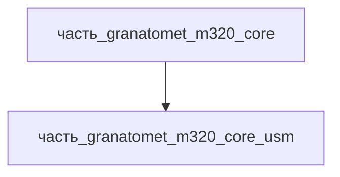

# Часть: часть_granatomet_m320_core_usm

## Описание

Ударно-спусковой механизм (УСМ) с пистолетной рукояткой и ручным предохранителем + пружинный механизм закрывания ствола (SAR teardown). Корпус УСМ — алюминиевый сплав; боёк, оси и пружины (боевая, спусковая, закрывания ствола) — пружинная сталь A229 (маслоотпущенная). УСМ двойного действия: накол капсюля без ручного взведения, ручной флажковый предохранитель блокирует спуск и шептало. Габариты 180×50×120 мм (спусковая скоба + рукоятка + пружина закрывания по высоте). Масса 0.30 кг — оценка. Полимерная рукоятка — в описании; в BOM принята алюминиевая основа корпуса.

Родитель: `часть_granatomet_m320_core` (подсистема: встроенное_оружие).

## Технические характеристики

| Параметр | Значение | Единица | Источник |
|---|---|---|---|
| подсистема | встроенное_оружие | — | canon |
| подтип | ударно-спусковой_механизм | — | canon |
| масса | 0.30 | kg | оценка: доля ствольной группы 1.2 кг (SAR/Wikipedia геометрия) |
| доля массы родителя | 0.25 | — | расчёт (0.30 / 1.2 кг core) |
| габариты (Д×Ш×В) | 180×50×120 | mm | AG36 350×90×210 (Wikipedia): доля по архитектуре break-action |
| выработка энергии | 0 | W | пассивная/механическая часть — генерации нет |
| выработка тепла | 0 | W | механический узел — тепла не выделяет |
| материал | al_6061-t6 | — | SAR: «aircraft-grade aluminum» / «mostly aluminum alloy» → `al_6061-t6.md` |
| форма материала | корпуса_электроники | — | al_6061-t6: корпуса_электроники (варианты_по_применению) |

## Принцип работы

При нажатии на спусковой крючок УСМ двойного действия досылает боёк пружиной на капсюль; флажковый предохранитель блокирует шептало и движение бойка. Пружина закрывания возвращает ствол в замкнутое положение и удерживает его до следующего перезаряжания. Пружины A229 после навивки подвергаются отпуску (низкий отжиг) для стабилизации упругих характеристик. Тепла не выделяет (0 Вт) — механический узел, нагрев ствольной группы его не касается.

## Состав

Атомарная часть (уровень 3, неделимый): закупочный/заводской узел, в полевых условиях не разбирается.

## Используемые материалы

- `al_6061-t6` → [`al_6061-t6.md`](../../../../../материалы/al_6061-t6.md) — корпуса_электроники
- `spring_steel` → [`spring_steel.md`](../../../../../материалы/spring_steel.md) — боёк, оси, пружины (A229 маслоотпущенная), вторичный материал в тексте

## Источники

- Small Arms Review, «HK AG36 40x46mm Grenade Launcher» (2003): ресивер — aluminum alloy со стальной вставкой бойка; ствол — aircraft-grade aluminum — https://smallarmsreview.com/hk-ag36-40x46mm-grenade-launcher (обращение 2026-11-07)
- Wikipedia «M320 Grenade Launcher Module» (1.5 кг, ствол 280 мм, 76 м/с, 5–7 выстр/мин, 150/350/400 м) — https://en.wikipedia.org/wiki/M320_Grenade_Launcher_Module (обращение 2026-11-07)
- Канон: декомпозиция `часть_granatomet_m320_core` (F34, 2026-11-07)
- Материалы: реальные данные/материалы/

## Декомпозиция

