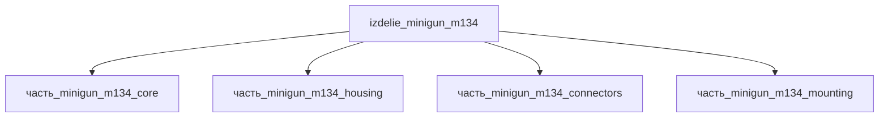

# Изделие: Minigun M134

## Описание

Minigun M134

Полное наименование (как в CSV): `Minigun M134`

## Технические характеристики

| Параметр | Значение | Единица | Источник |
|---|---|---|---|
| подсистема | встроенное_оружие | — | classify_subsystem |
| категория | прочее | — | — |

(Параметры требуют уточнения через веб-поиск и вычислений; см. fc_изделие_масса, fc_изделие_стандарты в _field_contracts.yaml)

## Состав

Изделие верхнего уровня. Дочерние части не указаны (требуется декомпозиция).

## Используемые технологии

- [`frezervanie_chpu`](../../../технологии/frezervanie_chpu.md) — ЧПУ-фрезерование: обработка деталей core (Ст3, крепёж и элементы блока) и корпуса housing (Ti-6Al-4V, 5-осевое фрезерование — стандарт авиационного производства титановых корпусов/кронштейнов, Carr Machine: «structural brackets, housings, fittings… in Ti-6Al-4V with 5-axis milling»; режимы для Ti: carbide-инструмент, низкие скорости резания ~150–200 SFM, высоконапорная СОЖ — ptsmake)

## Используемые материалы

(Ссылки на реальные_данные/материалы/ добавляются после связывания)

## Принцип работы

Требует описания на основе инженерного анализа.

## Источники

- CSV: `начальные данные_final.csv` (пользовательский ввод)
- [Wikipedia: M134 Minigun — 7.62×51mm NATO, 6 стволов, 2000–6000 выстр/мин](https://en.wikipedia.org/wiki/M134_Minigun)
- [Seaforces.org: M134 Mk.44 GAU-17A — вес 39/19 кг, длина 31.56 in, ствол 558.8 мм](https://www.seaforces.org/wpnsys/SURFACE/M134-minigun.htm)
- [Carr Machine & Tool: Ti-6Al-4V CNC Machining — 5-axis milling housings/brackets/fittings](https://carrmachine.com/materials/ti-6al-4v-machining) (обращение 2026-11-08)
- [PTSMake: How to Effectively Machine Titanium Grade 5 (Ti-6Al-4V) — carbide tool, 150–200 SFM, high-pressure coolant](https://www.ptsmake.com/how-to-effectively-machine-titanium-grade-5-ti-6al-4v) (обращение 2026-11-08)

---

## Декомпозиция

### Верификация габаритов (web_search 2026-11-07)

M134 Minigun: **длина 801.6 мм** (31.56 in), ширина 304.8 мм (12.0 in), высота 241.3 мм (9.5 in), масса 39 кг / 19 кг lightweight, длина ствола 558.8 мм (22 in) — Wikipedia M134 / General Dynamics spec.
