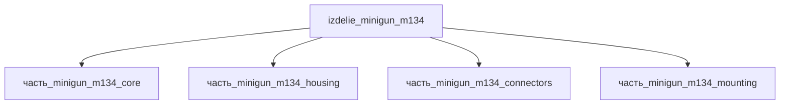

# Изделие: Minigun M134

## Описание

Minigun M134

Полное наименование (как в CSV): `Minigun M134`

## Технические характеристики

| Параметр | Значение | Единица | Источник |
|---|---|---|---|
| подсистема | встроенное_оружие | — | classify_subsystem |
| категория | прочее | — | — |

(Параметры требуют уточнения через веб-поиск и вычислений; см. fc_изделие_масса, fc_изделие_стандарты в _field_contracts.yaml)

## Состав

Изделие верхнего уровня. Дочерние части не указаны (требуется декомпозиция).

## Используемые технологии

(Ссылки на реальные_данные/технологии/ добавляются после связывания)

## Используемые материалы

(Ссылки на реальные_данные/материалы/ добавляются после связывания)

## Принцип работы

Требует описания на основе инженерного анализа.

## Источники

- CSV: `начальные данные_final.csv` (пользовательский ввод)

---

## Декомпозиция

### Верификация габаритов (web_search 2026-11-07)

M134 Minigun: **длина 801.6 мм** (31.56 in), ширина 304.8 мм (12.0 in), высота 241.3 мм (9.5 in), масса 39 кг / 19 кг lightweight, длина ствола 558.8 мм (22 in) — Wikipedia M134 / General Dynamics spec.
