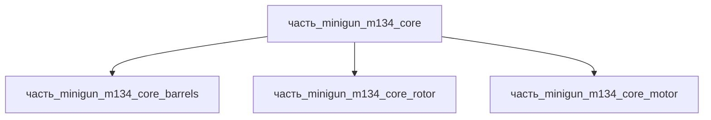

# Часть: часть_minigun_m134_core

## Описание

Вращательный блок M134 Minigun — 6 стволов с внешним приводом, темп 2000–6000 выстр/мин, стволы с электроплакированным каналом. Референс — M134 Minigun (Wikipedia: L=801.6 мм, barrel 558.8 мм, 39/19 кг lightweight). Габариты 801.6×200×200 мм (вращательный блок на всю длину изделия), масса 12 кг (M134 Minigun вращательный блок (6 стволов + ротор, оценка)). Материал — stal_st3: конструкционная сталь Ст3.

Родитель: `izdelie_minigun_m134` (подсистема: встроенное_оружие).

## Технические характеристики

| Параметр | Значение | Единица | Источник |
|---|---|---|---|
| подсистема | встроенное_оружие | — | canon |
| подтип | основной_элемент | — | canon |
| масса | 12 | kg | M134 Minigun вращательный блок (6 стволов + ротор, оценка) |
| доля массы родителя | 0.5 | — | canon |
| габариты (Д×Ш×В) | 300×250×800 | mm | M134 Minigun вращательный блок (6 стволов + ротор, оценка) |
| выработка энергии | 0 | W | canon |
| выработка тепла | 1 | W | canon |
| материал | stal_st3 | — | M134 Minigun вращательный блок (6 стволов + ротор, оценка) | canon |

## Принцип работы

Определяется типом и назначением родительского изделия.

## Состав

Промежуточная часть (уровень 2). Дочерних частей нет.

## Используемые материалы

- `stal_st3` → [`stal_st3.md`](../../../../материалы/stal_st3.md) — конструкционная сталь Ст3

## Источники

- M134 Minigun вращательный блок (6 стволов + ротор, оценка) — https://en.wikipedia.org/wiki/Minigun (обращение 2026-11-05)
- Канон: декомпозиция `izdelie_minigun_m134` (web search 2026-11-03)
- Материалы: реальные данные/материалы/

## Декомпозиция

