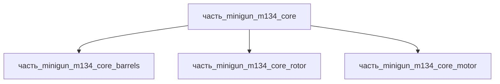

# Часть: часть_minigun_m134_core

## Описание

Вращательный блок (core) M134 Minigun — 6 стволов с внешним приводом, темп 2000–6000 выстр/мин. Референс — M134 Minigun (Wikipedia: L=801.6 мм, barrel 558.8 мм, 39/19 кг lightweight). По Wikipedia, «The core of the M134D was a steel housing and rotor» — ядро M134D представляет собой стальной корпус и ротор (ресурс корпуса 500 000 выстрелов; вариант M134D-H — стальной корпус + титановый ротор). Габариты 801.6×200×200 мм (вращательный блок на всю длину изделия), масса 12 кг (оценка: стальной корпус + ротор стальной части блока). Материал — stal_st3, форма «строительные_конструкции_и_крепёж» (ГОСТ 535-2005 / EN 10025-2 S235JR): корпус блока — сварно-листовая несущая конструкция (лист/профиль, сварные узлы), стволовая сталь и двигатели учтены в дочерних частях core_barrels и core_motor.

Родитель: `izdelie_minigun_m134` (подсистема: встроенное_оружие).

## Технические характеристики

| Параметр | Значение | Единица | Источник |
|---|---|---|---|
| подсистема | встроенное_оружие | — | canon |
| подтип | основной_элемент | — | canon |
| масса | 12 | kg | M134 Minigun вращательный блок (6 стволов + ротор, оценка) |
| доля массы родителя | 0.5 | — | canon |
| габариты (Д×Ш×В) | 801.6×200×200 | mm | Wikipedia M134 Minigun (L=801.6 мм) |
| выработка энергии | 0 | W | canon |
| выработка тепла | 1 | W | canon |
| материал | stal_st3 (форма: строительные_конструкции_и_крепёж) | — | Wikipedia M134D: steel housing and rotor |

## Принцип работы

Определяется типом и назначением родительского изделия.

## Состав

Промежуточная часть (уровень 2). Дочерних частей нет.

## Используемые материалы

- `stal_st3` → [`stal_st3.md`](../../../../материалы/stal_st3.md) — конструкционная сталь Ст3

## Источники

- Wikipedia M134 Minigun: «The core of the M134D was a steel housing and rotor», ресурс корпуса 500 000 выстрелов — https://en.wikipedia.org/wiki/M134_Minigun (обращение 2026-11-08)
- Форма материала: вариант «строительные_конструкции_и_крепёж» материала stal_st3 (реальные данные/материалы/stal_st3.md, ГОСТ 535-2005 / EN 10025-2 S235JR)
- Канон: декомпозиция `izdelie_minigun_m134` (web search 2026-11-03)
- Материалы: реальные данные/материалы/

## Декомпозиция

