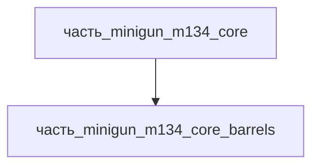

# Часть: часть_minigun_m134_core_barrels

## Описание

Пакет 6 стволов 7.62×51мм NATO (M134: 559–686 мм, хромированный канал, скорострельность до 6000 выстр/мин на пакет). Каждый ствол с собственным затворным блоком, циклируется вращением вокруг центральной оси. Референс — General Dynamics M134 spec (barrel cluster).

Родитель: `часть_minigun_m134_core` (подсистема: встроенное_оружие).

## Технические характеристики

| Параметр | Значение | Единица | Источник |
|---|---|---|---|
| подсистема | встроенное_оружие | — | canon |
| подтип | стволы | — | canon |
| масса_kg | 4.2 | кг | General Dynamics M134 spec / Wikipedia |
| габариты_mm | 559×150×150 | мм | пакет 6 стволов по 558.8 мм (22 in), ширина/высота пакета ~150 мм |
| материал | stal_st3 | — | реальный материал |

## Используемые технологии

- [`honing_plateau_finish`](../../../../технологии/honing_plateau_finish.md) — хонингование канала ствола: глубокое сверление заготовки (gun drilling) и доводка канала перед хромированием (Gül: «deep hole drilling, honing, straightening, broaching, chrome plating, heat treatment» — стандарт военного производства стволов)
- [`galvanika`](../../../../технологии/galvanika.md) — гальваническое хромирование канала (hard chrome lining): электролитическое нанесение твёрдого хрома на канал ствола против эрозии и коррозии; описание стволов M134 прямо указывает «хромированный канал» (Wikipedia M134); SERDP-ESTCP подтверждает гальваническое hexavalent chrome plating как действующий процесс для стволов среднего калибра

## Источники

- SERDP-ESTCP WP-1502, «Chromium Elimination in Medium Caliber Gun Barrels» (hexavalent chrome plating стволов): <https://serdp-estcp.mil/projects/details/fad914b6-1e49-4e9b-9de2-f9a86d256aea>
- Gül, «Specialized Processes in the Manufacturing of Military Firearm Barrels» (deep hole drilling → honing → broaching → chrome plating → heat treatment): <https://www.linkedin.com/pulse/specialized-processes-manufacturing-military-firearm-barrels-g%C3%BCl-xpuhf>
- Practical Machinist, «Barrel Making 101» (равномерный слой hard chrome по нарезам): <https://www.practicalmachinist.com/forum/threads/barrel-making-101.224668>
- Wikipedia: M134 Minigun (6 стволов 7.62×51, хромированный канал, 2000–6000 выстр/мин): <https://en.wikipedia.org/wiki/M134_Minigun>

## Иерархия

