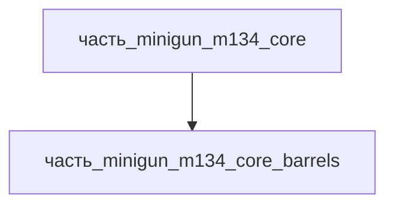

# Часть: часть_minigun_m134_core_barrels

## Описание

Пакет 6 стволов 7.62×51мм NATO (M134: 559–686 мм, хромированный канал, скорострельность до 6000 выстр/мин на пакет). Каждый ствол с собственным затворным блоком, циклируется вращением вокруг центральной оси. Референс — General Dynamics M134 spec (barrel cluster).

Родитель: `часть_minigun_m134_core` (подсистема: встроенное_оружие).

## Технические характеристики

| Параметр | Значение | Единица | Источник |
|---|---|---|---|
| подсистема | встроенное_оружие | — | canon |
| подтип | стволы | — | canon |
| масса_kg | 4.2 | кг | General Dynamics M134 spec / Wikipedia |
| габариты_mm | 559×150×150 | мм | пакет 6 стволов по 558.8 мм (22 in), ширина/высота пакета ~150 мм |
| материал | stal_st3 | — | реальный материал |

## Иерархия

