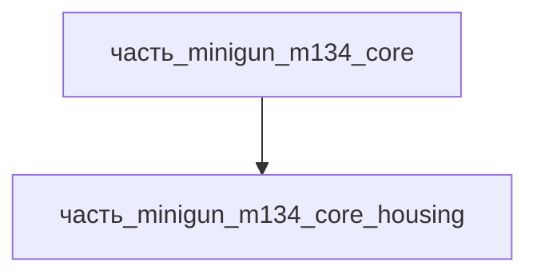

# Часть: часть_minigun_m134_core_housing

## Описание

Корпус вращательного блока: передняя плита крепления пакета стволов, посадочные места ротора и редуктора, узлы соединения с приёмником и крепёжной рамой. Референс — M134 receiver housing (General Dynamics).

Родитель: `часть_minigun_m134_core` (подсистема: встроенное_оружие).

## Технические характеристики

| Параметр | Значение | Единица | Источник |
|---|---|---|---|
| подсистема | встроенное_оружие | — | canon |
| подтип | корпус | — | canon |
| масса_kg | 2.0 | кг | General Dynamics M134 spec / Wikipedia |
| габариты_mm | 300×250×200 | мм | оценка по типовым изделиям класса |
| материал | al_6061-t6 | — | реальный материал |

## Иерархия

