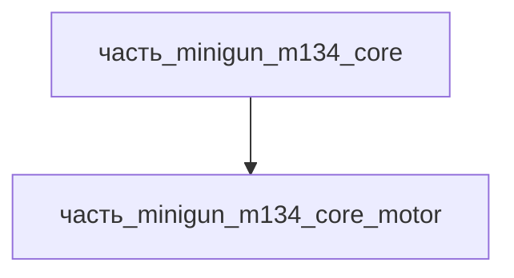

# Часть: часть_minigun_m134_core_motor

## Описание

Внешний электропривод вращательного блока (DC motor ~4-6 л.с., 24-28 V DC, регулировка темпа 2000-6000 выстр/мин). Через редуктор передаёт вращение ротору. Референс — M134 electric drive (General Dynamics).

Родитель: `часть_minigun_m134_core` (подсистема: встроенное_оружие).

## Технические характеристики

| Параметр | Значение | Единица | Источник |
|---|---|---|---|
| подсистема | встроенное_оружие | — | canon |
| подтип | электропривод | — | canon |
| масса_kg | 2.8 | кг | General Dynamics M134 spec / Wikipedia |
| габариты_mm | 200×150×150 | мм | оценка по типовым изделиям класса |
| материал | stal_st3 | — | реальный материал |

## Используемые технологии

- [`frezervanie_chpu`](../../../../технологии/frezervanie_chpu.md) — ЧПУ-обработка ярма и корпуса электродвигателя из конструкционной стали: посадочные места под подшипники вала и фланец редуктора, соосность корпуса ротора определяет вибрацию привода при 2000–6000 об/мин
- [`spiralnaya_navivka`](../../../../технологии/spiralnaya_navivka.md) — спиральная намотка медного обмоточного провода якоря DC-двигателя (24–28 В, ~4–6 л.с.): прецедент — часть_SkyNet-LegActuator_knee_двигатель (spiralnaya_navivka + copper, роль обмоточный_провод)

## Источники

- Wikipedia: M134 Minigun — электропривод, регулировка темпа 2000–6000 выстр/мин: <https://en.wikipedia.org/wiki/M134_Minigun>
- Обмотки электродвигателей малой мощности — спиральная/пазовая намотка медного провода: каталог технологии [`spiralnaya_navivka.md`](../../../../технологии/spiralnaya_navivka.md)

## Иерархия

