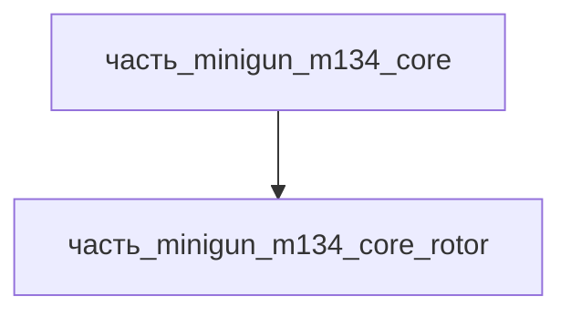

# Часть: часть_minigun_m134_core_rotor

## Описание

Ротор вращательного блока с кулачковыми пазами (cam track) для циклирования затворов 6 стволов. Вращается вокруг центральной оси, обеспечивает последовательное запирание/выстрел/экстракцию каждого ствола. Референс — M134 rotor assembly (General Dynamics).

Родитель: `часть_minigun_m134_core` (подсистема: встроенное_оружие).

## Технические характеристики

| Параметр | Значение | Единица | Источник |
|---|---|---|---|
| подсистема | встроенное_оружие | — | canon |
| подтип | ротор | — | canon |
| масса_kg | 3.0 | кг | General Dynamics M134 spec / Wikipedia |
| габариты_mm | 250×250×200 | мм | оценка по типовым изделиям класса |
| материал | stal_st3 | — | реальный материал |

## Иерархия

