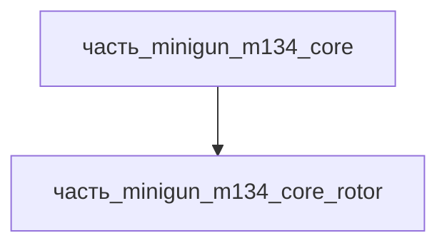

# Часть: часть_minigun_m134_core_rotor

## Описание

Ротор вращательного блока с кулачковыми пазами (cam track) для циклирования затворов 6 стволов. Вращается вокруг центральной оси, обеспечивает последовательное запирание/выстрел/экстракцию каждого ствола. Референс — M134 rotor assembly (General Dynamics). Форма материала — **валы_оси_и_токарные_детали** (вариант Ст3 из круглого сортового/калиброванного проката по ГОСТ 2590-2006, круг Ø5–270 мм): массивная цилиндрическая заготовка, токарная обработка центрального отверстия и посадочных шеек, фрезерование спирального кулачкового паза в массиве (по одному циклу на ствол × 6); сталь Ст3 — малоуглеродистая (σв 370–510 МПа, σт 235 МПа, ГОСТ 535-2005/S235JR), сопоставимо с конструкционной сталью корпуса/ротора M134 (Wikipedia M134: «steel housing and rotor», см. #827).

Родитель: `часть_minigun_m134_core` (подсистема: встроенное_оружие).

## Технические характеристики

| Параметр | Значение | Единица | Источник |
|---|---|---|---|
| подсистема | встроенное_оружие | — | canon |
| подтип | ротор | — | canon |
| масса_kg | 3.0 | кг | General Dynamics M134 spec / Wikipedia |
| габариты_mm | 150×150×150 | мм | YAML основные.габариты_mm (синхронизировано) |
| материал | stal_st3 | — | реальный материал |
| форма материала | валы_оси_и_токарные_детали | — | ГОСТ 2590-2006 круг Ø5–270 мм (ros-met.com/gost-2590-2006-krug-stalnoj); круг стальной → оси, тяги, рычаги, валы (metallotorg.ru/info/metalloprokat/krug_stalnoy); механическая обработка кулачкового паза в массиве |

## Иерархия

