# Изделие: GR801 NOEL-V RISC-V

## Описание

GR801 — радиационно-стойкий SoC Frontgrade Gaisler: одножерный RISC-V NOEL-V (RV64GC) для системного управления + нейроморфный AI-движок Brainchip Akida™ 1.0 (8 узлов, 1024 MAC/такт, 1–4-битное квантование) на 28 нм FDSOI, корпус FCTEBGA 23×23 мм, 441 ball

Полное наименование (как в CSV): `GR801 NOEL-V RISC-V (rad-hard)`

## Технические характеристики

| Параметр | Значение | Единица | Источник |
|---|---|---|---|
| подсистема | вычислительная | — | classify_subsystem |
| габариты (Д×Ш×В) | 40×40×3.5 | mm | SoC-модуль: PCB 40×40×1.6 + шары 0.4 + пакет FCTEBGA 23×23×1.5 (gaisler.com) |
| выработка тепла | 3 | W | тепловой бюджет SoC-модуля: NOEL-V (core 1.0 В) + Akida, 28 нм FDSOI; min 1 / max 5 Вт |
| техпроцесс | 28 нм FDSOI | — | STMicroelectronics (gaisler.com/products/gr801) |
| стойкость | TID 50–100 krad(Si), SEL ≥60 МэВ·см²/мг | — | gaisler.com/products/gr801 |
| категория | электроника | — | canon |

(Параметры требуют уточнения через веб-поиск и вычислений; см. fc_изделие_масса, fc_изделие_стандарты в _field_contracts.yaml)

## Состав

SoC-модуль GR801 (уровень 1), 10 частей (уровень 2): die (кристалл NOEL-V+Akida 8×8×0.5, 3 Вт — весь тепловой бюджет), package (FCTEBGA 23×23×1.5, 441 ball), substrate (23×23×1.0), pins (BGA-шары 21×21, шаг 1 мм), thermal_pad, pcb — несущая плата 40×40×1.6 (fanout BGA, 8 слоёв), flash (QSPI 8×6), sram (4×3), crystal_osc (3225: 3.2×2.5), capacitors (MLCC 0402). Тепловой баланс: 3 Вт выделяется в кристалле и отводится через термопрокладку/подложку/плату.

## Используемые технологии

(Ссылки на реальные_данные/технологии/ добавляются после связывания)

## Используемые материалы

(Ссылки на реальные_данные/материалы/ добавляются после связывания)

## Принцип работы

NOEL-V (RV64GC) исполняет ОС и конвейер данных; AI-нагрузка (камера CPI, SpaceWire-потоки) уходит в Akida: SNN исполняются событийно — вычисление активируется только спайками, квантование 1–4 бита; FDSOI даёт подложечное смещение (энергоэффективность) и встроенную стойкость к одиночным событиям. Всё тепловыделение (номинал 3 Вт, min 1 / max 5) депонируется в кристалле и отводится пассивно: die → thermal_pad/подложка → плата. Вывод — PCIe Gen3 x4 или GbE в бортовой контур.

## Источники

- Frontgrade Gaisler, «GR801» — RV64GC (NOEL-V) + Akida 1.0, 28 нм FDSOI, FCTEBGA 23×23 мм, TID/SEL: https://www.gaisler.com/products/gr801 (проверено 2026-11-07)
- CSV: `начальные данные_final.csv` (пользовательский ввод)

---

## Декомпозиция

```mermaid
graph TD
    gr801_noel-v_risc-v["izdelie_gr801_noel-v_risc-v"]
    gr801_noel-v_risc-v_die["часть_gr801_noel-v_risc-v_die"]
    gr801_noel-v_risc-v --> gr801_noel-v_risc-v_die
    gr801_noel-v_risc-v_packa["часть_gr801_noel-v_risc-v_package"]
    gr801_noel-v_risc-v --> gr801_noel-v_risc-v_packa
    gr801_noel-v_risc-v_cryst["часть_gr801_noel-v_risc-v_crystal_osc"]
    gr801_noel-v_risc-v --> gr801_noel-v_risc-v_cryst
    gr801_noel-v_risc-v_flash["часть_gr801_noel-v_risc-v_flash"]
    gr801_noel-v_risc-v --> gr801_noel-v_risc-v_flash
    gr801_noel-v_risc-v_sram["часть_gr801_noel-v_risc-v_sram"]
    gr801_noel-v_risc-v --> gr801_noel-v_risc-v_sram
    gr801_noel-v_risc-v_subst["часть_gr801_noel-v_risc-v_substrate"]
    gr801_noel-v_risc-v --> gr801_noel-v_risc-v_subst
    gr801_noel-v_risc-v_therm["часть_gr801_noel-v_risc-v_thermal_pad"]
    gr801_noel-v_risc-v --> gr801_noel-v_risc-v_therm
    gr801_noel-v_risc-v_pins["часть_gr801_noel-v_risc-v_pins"]
    gr801_noel-v_risc-v --> gr801_noel-v_risc-v_pins
    gr801_noel-v_risc-v_capac["часть_gr801_noel-v_risc-v_capacitors"]
    gr801_noel-v_risc-v --> gr801_noel-v_risc-v_capac
    gr801_noel-v_risc-v_pcb["часть_gr801_noel-v_risc-v_pcb"]
    gr801_noel-v_risc-v --> gr801_noel-v_risc-v_pcb
```

