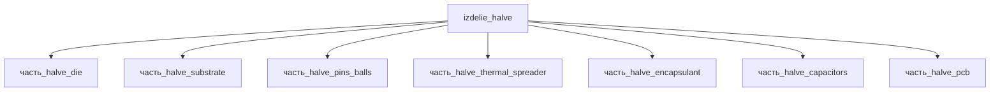

# Изделие: HALVE

## Описание

HALVE — нейроморфный процессор в форм-факторе M.2-модуля: плата-носитель FR-4 (M.2 2280, 80×22×0.8 мм) с BGA-пакетом 12×12 мм — кристалл 4×4 мм (Intel 4, 7 нм), медный теплораспределитель (IHS), эпоксидный glob-top, шары BGA Sn63/Pb37 и блок керамических MLCC-конденсаторов развязки питания. Форм-фактор подтверждён практикой отрасли: BrainChip AKD1000 выпускается в виде M.2-карт (B+M Key / E Key), Loihi 2 Intel — на add-in-картах (Oheo Gulch — одночиповая карта с Arria 10 FPGA, Kapoho Point — 8-чиповая система ~4×4″).

Полное наименование (как в CSV): `HALVE`

## Технические характеристики

| Параметр | Значение | Единица | Источник |
|---|---|---|---|
| подсистема | вычислительная | — | classify_subsystem |
| категория | прочее | — | — |
| габариты (Д×Ш×В) | 80×22×2.8 | mm | M.2 2280 (PCB 0.8±0.08 мм, Wikipedia M.2) + BGA-пакет ≈2.0 мм (substrate 0.6 + cavity + IHS 0.5) |

(Параметры требуют уточнения через веб-поиск и вычислений; см. fc_изделие_масса, fc_изделие_стандарты в _field_contracts.yaml)

## Состав

M.2-модуль нейроморфного процессора (уровень 1), 7 дочерних частей:

- `часть_halve_die` — кремниевый кристалл 4×4×0.5 мм (Intel 4, 7 нм)
- `часть_halve_substrate` — корпусная IC-подложка BGA 12×12×0.6 мм
- `часть_halve_pins_balls` — шары BGA Sn63/Pb37 Ø0.4 мм
- `часть_halve_thermal_spreader` — медный теплораспределитель (IHS) 12×12×0.5 мм
- `часть_halve_encapsulant` — эпоксидный glob-top 10×10×0.5 мм
- `часть_halve_capacitors` — MLCC развязки питания 0805 (2×1.25×0.8 мм)
- `часть_halve_pcb` — плата-носитель FR-4, M.2 2280 (80×22×0.8 мм)

## Используемые технологии

(Ссылки на реальные_данные/технологии/ добавляются после связывания)

## Используемые материалы

(Ссылки на реальные_данные/материалы/ добавляются после связывания)

## Принцип работы

Требует описания на основе инженерного анализа.

## Источники

- CSV: `начальные данные_final.csv` (пользовательский ввод)
- https://en.wikipedia.org/wiki/M.2 — M.2 2280: 22 мм ширина × 80 мм длина, PCB 0.8 мм ±10%, компоненты ≤1.5 мм/сторону (обращение 2026-11-08)
- https://brainchip.com/upgrade-the-raspberry-pi-for-ai-with-a-neuromorphic-processor — BrainChip AKD1000: нейроморфный процессор в виде M.2-карт (B+M Key / E Key)
- https://www.intel.com/content/dam/www/central-libraries/us/en/documents/neuromorphic-computing-loihi-2-brief.pdf — Intel Loihi 2 brief: Oheo Gulch (одночиповая карта, Arria 10 FPGA), Kapoho Point (8 чипов, ~4×4″)

---

## Декомпозиция

