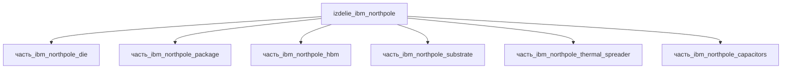

# Изделие: IBM NorthPole

## Описание

IBM NorthPole

Полное наименование (как в CSV): `IBM NorthPole`

Нейросетевой инференс-ускоритель IBM Research (группа Dharmendra Modha): кристалл 795–800 мм² по 12 нм с 22 млрд транзисторов, 256 вычислительных ядер в матрице 16×16 при такте ~400 МГц; вычисления и память интегрированы на одном кристалле (192 МБ распределённой памяти на ядрах, ~13 ТБ/с внутренней пропускной способности) — внешняя память исключена из цикла, что устраняет von-Neumann-узкое место. Модуль собран по FCBGA: кристалл на подложке 55×55 мм с тепловым распределителем и прижимом; класс точности — промышленный (IBM Research, Science 382, 2023).

## Технические характеристики

| Параметр | Значение | Единица | Источник |
|---|---|---|---|
| подсистема | вычислительная | — | classify_subsystem |
| категория | электроника | — | canon |
| габариты (Д×Ш×В) | 55×55×6.5 | mm | envelope FCBGA-сборки (стек: BGA standoff 0.6 + подложка 1.2 + корпус 3.0 + теплоотвод 1.0 + TIM 0.1 + зазор 0.6) — посадочный контур подложки/корпуса 55×55 |
| кристалл | 795–800 | mm² | 12 нм, 22 млрд транзисторов — IBM Research blog (research.ibm.com/blog/northpole-ibm-ai-chip); die-ребёнок 28.2×28.2 мм согласован |

## Состав

Изделие верхнего уровня (вычислительная подсистема, AI-инференс). 6 дочерних частей: кристалл (`часть_ibm_northpole_die`, 28.2×28.2×0.775 мм — 795 мм², 12 нм, 22 млрд транзисторов), корпус FCBGA (`часть_ibm_northpole_package`, 55×55×3), память HBM (`часть_ibm_northpole_hbm`, 11×10×1.2), органическая подложка (`часть_ibm_northpole_substrate`, 55×55×1.2), тепловой распределитель (`часть_ibm_northpole_thermal_spreader`, 28.3×28.3×1.0, медь), конденсаторный блок (`часть_ibm_northpole_capacitors`, MLCC 2×1.25×0.9).

## Используемые технологии

(Ссылки на реальные_данные/технологии/ добавляются после связывания)

## Используемые материалы

(Ссылки на реальные_данные/материалы/ добавляются после связывания)

## Принцип работы

Архитектура «пространственного» нейроинференса: 256 ядер (матрица 16×16) с интегрированной на кристалле памятью обрабатывают нейросеть как последовательность кадров — данные поступают через DMA извне фреймами, синапсы ядра программируются побайтово, активации передаются по сети на кристалле (~13 ТБ/с) без обращений к внешней памяти в цикле инференса. Поддержка INT2/INT4/INT8 даёт 2/4/8 операций на ядро за такт при 400 МГц (4640 TOPS по канону файла); при TDP-классе 75 Вт (канон) модуль рассеивает тепло через медный распределитель и прижим. Энергоэффективность в тестах IBM — ~25× выше сопоставимых GPU/CPU при латентности <1 мс на токен (IBM Research, 2023–2024).

## Источники

- CSV: `начальные данные_final.csv` (пользовательский ввод)
- IBM Research — IBM's new NorthPole AI chip (12 нм, 22 млрд транзисторов в 800 мм², 256 ядер): https://research.ibm.com/blog/northpole-ibm-ai-chip (проверено 2026-11-08)
- Modha D.S. et al. — Neural inference at the frontier of energy, space, and time, Science 382 (2023-10-20), DOI 10.1126/science.adh1174: https://www.science.org/doi/10.1126/science.adh1174 (проверено 2026-11-08)

---

## Декомпозиция

