# Изделие: Intel Loihi 2

## Описание

Intel Loihi 2 — нейроморфный исследовательский процессор второго поколения (Intel Labs, 2021): 128 полностью асинхронных нейронных ядер, до 1 млн нейронов и 120 млн синапсов на чип, программируемые динамики LIF-нейронов, асинхронный NoC (network-on-chip); техпроцесс Intel 4 (EUV). Пакет — BGA с BT-подложкой (bismaleimide triazine), Cu-теплосъёмником и MLCC-развязкой питания.

## Технические характеристики

| Параметр | Значение | Единица | Источник |
|---|---|---|---|
| подсистема | вычислительная | — | classify_subsystem |
| категория | электроника | — | синхронизировано с YAML |
| нейронные ядра | 128 (полностью асинхронные) | шт | Intel Loihi 2 brief (intel.com) |
| нейроны | до 1 000 000 | шт | Intel Loihi 2 / open-neuromorphic.org |
| синапсы | 120 000 000 | шт | open-neuromorphic.org |
| техпроцесс | Intel 4 (EUV) | — | Intel Loihi 2 brief |
| масса | 0.01 (0.005–0.05) | kg | канон |
| выработка тепла | 1.0 (0.5–1.5) | W | канон |

## Состав

Изделие верхнего уровня — BGA-пакет нейроморфного процессора, 7 дочерних частей:

- `часть_intel_loihi_2_die` — кристалл Intel 4 (128 ядер, ~31 мм²)
- `часть_intel_loihi_2_substrate` — BT-подложка (bismaleimide triazine) с переразводкой
- `часть_intel_loihi_2_pins_balls` — BGA-выводы (шарики припоя на выводной рамке)
- `часть_intel_loihi_2_thermal_spreader` — Cu-теплосъёмник (lid)
- `часть_intel_loihi_2_encapsulant` — эпоксидная капсуляция пакета
- `часть_intel_loihi_2_capacitors` — MLCC-развязка питания
- `часть_intel_loihi_2_pcb` — несущая печатная плата

## Используемые технологии

(Ссылки на реальные_данные/технологии/ добавляются после связывания)

## Используемые материалы

(Ссылки на реальные_данные/материалы/ добавляются после связывания)

## Принцип работы

Каждое из 128 ядер содержит генераторы спайков LIF-нейронов с программируемыми динамиками и синаптическую память; ядра соединены асинхронным NoC (network-on-chip) с 6-кратным иерархическим сжатием трафика. Событийная (event-driven) передача: нейрон выдаёт спайк только при превышении порога мембранного потенциала, питание расходуется пропорционально активности — отсюда низкое тепловыделение (1 Вт) против GPU. Кристалл смонтирован на BT-подложке (bare-die), теплосъём через Cu-крышку, питание фильтруется MLCC-блоком; BGA-выводы обеспечивают монтажную посадку на несущую плату.

## Источники

- CSV: `начальные данные_final.csv` (пользовательский ввод)
- Intel Labs — Next-Level Neuromorphic Computing: Intel Lab's Loihi 2 Chip: https://www.intel.com/content/www/us/en/research/neuromorphic-computing-loihi-2-technology (проверено 2026-11-09)
- Open Neuromorphic — A Look at Loihi 2 (128 ядер, 1 млн нейронов, 120 млн синапсов): https://open-neuromorphic.org/neuromorphic-computing/hardware/loihi-2-intel (проверено 2026-11-09)

---

## Декомпозиция

```mermaid
graph TD
    intel_loihi_2["izdelie_intel_loihi_2"]
    intel_loihi_2_die["часть_intel_loihi_2_die"]
    intel_loihi_2 --> intel_loihi_2_die
    intel_loihi_2_substrate["часть_intel_loihi_2_substrate"]
    intel_loihi_2 --> intel_loihi_2_substrate
    intel_loihi_2_pins_balls["часть_intel_loihi_2_pins_balls"]
    intel_loihi_2 --> intel_loihi_2_pins_balls
    intel_loihi_2_thermal_spr["часть_intel_loihi_2_thermal_spreader"]
    intel_loihi_2 --> intel_loihi_2_thermal_spr
    intel_loihi_2_encapsulant["часть_intel_loihi_2_encapsulant"]
    intel_loihi_2 --> intel_loihi_2_encapsulant
    intel_loihi_2_capacitors["часть_intel_loihi_2_capacitors"]
    intel_loihi_2 --> intel_loihi_2_capacitors
    intel_loihi_2_pcb["часть_intel_loihi_2_pcb"]
    intel_loihi_2 --> intel_loihi_2_pcb
```

