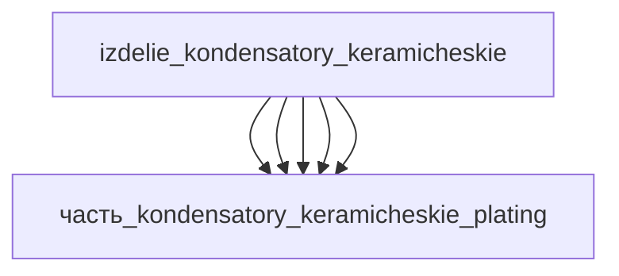

# Изделие: Конденсаторы: керамические

## Описание

Многослойный керамический конденсатор (MLCC) 0805-класса: 1 мкФ ±20 %, 50 В, X7R (−55…+125 °C, ΔC/C ±15 %, EIA RS-198 класс II) — референс Murata GCJ21BR71H105MA01K (2.0×1.25×1.25 мм, допуски ±0.3/±0.2/±0.2). BME-конструкция: никелевые внутренние электроды, ко-спечённые с X7R-диэлектриком на легированном BaTiO3 (core-shell, εr ~3000), Cu-терминация с Ni-барьером и matte-Sn финишем (AEC-Q200).

Полное наименование (как в CSV): `Конденсаторы: керамические (X7R)`

## Технические характеристики

| Параметр | Значение | Единица | Источник |
|---|---|---|---|
| подсистема | вычислительная | — | classify_subsystem |
| категория | электроника | — | синхронизировано с YAML |
| типоразмер | 0805 (2012 metric) | — | Murata GCJ21BR71H105MA01K |
| габариты корпуса | 2.0±0.3 × 1.25±0.2 × 1.25±0.2 (огибающая 2.3×1.45×1.45) | mm | Murata datasheet |
| ёмкость | 1 ±20 % | мкФ | Murata GCJ21BR71H105MA01K |
| номинальное напряжение | 50 | В | Murata GCJ21BR71H105MA01K |
| температурный класс | X7R (−55…+125 °C, ΔC/C ±15 %) | — | EIA RS-198, класс II |
| выработка тепла | 0.01 (0.001–0.05) | W | канон |
| выработка энергии | 0 | W | канон |

## Состав

Изделие верхнего уровня — MLCC 0805 (BME-конструкция), 5 дочерних частей:

- `часть_kondensatory_keramicheskie_ceramic_layers` — X7R-диэлектрик на BaTiO3 (керамический чип 1.5×1.25×1.25 мм между зонами терминации)
- `часть_kondensatory_keramicheskie_inner_electrodes` — Ni-стек внутренних электродов (~150 слоёв, footprint 1.3×1.0×0.15 мм)
- `часть_kondensatory_keramicheskie_outer_electrodes` — Cu-торцевой электрод (0.25×1.25×1.25 мм на торце)
- `часть_kondensatory_keramicheskie_termination` — Cu-плёнка терминации (~20 мкм, глубина 0.4 мм)
- `часть_kondensatory_keramicheskie_plating` — Ni-барьер + matte Sn финиш (~8 мкм)

## Используемые технологии

(Ссылки на реальные_данные/технологии/ добавляются после связывания)

## Используемые материалы

(Ссылки на реальные_данные/материалы/ добавляются после связывания)

## Принцип работы

Ёмкость набирается сотнями чередующихся слоёв: C = ε0·εr·N·A/d — X7R-диэлектрик (легированный BaTiO3, εr ~3000) между Ni-внутренними электродами; каждый слой выводится на противоположные торцы к Cu-терминации. Сегнетоэлектрическая поляризация тетрагонального BaTiO3 обеспечивает высокую εr; core-shell легирование (Dy/Ho/Y, Mn, Mg) стабилизирует класс X7R и делает BME-диэлектрик совместимым с Ni в восстановительном ко-спекании при 1150–1350 °C (NASA NTRS 20150004115). Cu-терминация с Ni-барьером и matte-Sn финишем образует паяемое покрытие, стойкое к перепайке (AEC-Q200).

## Источники

- CSV: `начальные данные_final.csv` (пользовательский ввод)
- Murata GCJ21BR71H105MA01K — MLCC 0805, 1 мкФ ±20 %, 50 В, X7R, размеры 2.0±0.3×1.25±0.2×1.25±0.2 мм, внешний терминал 0.2–0.7 мм: https://www.tme.eu/rs/en/details/gcg21br71h105ma01k/mlcc-smd-capacitors/murata (проверено 2026-11-08)
- Murata GCM21BR71H105MA03K (0805, 2.00×1.25 мм, толщина макс 1.45 мм — подтверждение предельной огибающей): https://www.digikey.com.br/en/products/detail/murata-electronics/GCM21BR71H105MA03K/10695904 (проверено 2026-11-08)

---

## Декомпозиция

