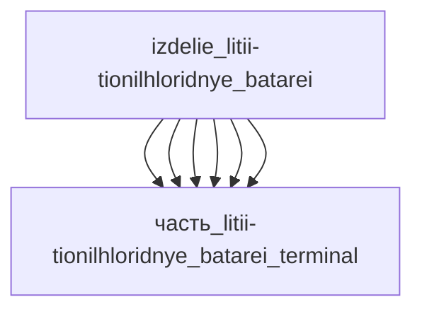

# Изделие: Литий-тионилхлоридные батареи

## Описание

Батарея из трёх литий-тионилхлоридных (Li-SOCl₂) bobbin-элементов D-размера, соединённых последовательно (3S1P → 10.8 В, 19 А·ч) — типовая заводская батарейная сборка для метрологических/телематических изделий. Каждый элемент — референс EVE ER34615 / Tadiran TL-5903 (Ø34.0–34.2 × 61.5 мм, 99–100 г): Li-анод-лайнер против стенки стального корпуса, пористый угольный бобин-катод (сажа + PTFE), стекловолоконный сепаратор, электролит LiAlCl₄/SOCl₂, герметичный корпус со стекло-металлическим вводом. Огибающая сборки 110×40×66 мм — три элемента в ряду в держателе.

Полное наименование (как в CSV): `Литий-тионилхлоридные батареи (Li-SOCl₂)`

## Технические характеристики

| Параметр | Значение | Единица | Источник |
|---|---|---|---|
| подсистема | вычислительная | — | classify_subsystem |
| категория | энергетика | — | синхронизировано с YAML |
| конфигурация батареи | 3S1P (3 элемента D последовательно) | — | типовая заводская сборка Li-SOCl2 |
| габариты батареи | 110×40×66 | mm | расчёт упаковки 3 элементов Ø34.2×61.5 + держатель (обоснование в YAML) |
| масса батареи | 0.3 (0.05–1.0) | kg | 3 × 100 г (элемент) + держатель |
| референс-элемент | EVE ER34615 / Tadiran TL-5903 (D, bobbin) | — | EVE/evlithium, Tadiran |
| номинальное напряжение | 3.6 (элемент) / 10.8 (батарея 3S1P) | В | EVE ER34615; 3×3.6=10.8 |
| ёмкость | 19 | Ач | EVE ER34615 |
| макс. непрерывный разряд | 230 | мА | EVE ER34615 (на элемент) |
| макс. импульсный разряд | 300 | мА | EVE ER34615 (на элемент) |
| масса элемента | 100 | г | EVE ER34615 |
| габариты элемента | Ø33.1–34.2 × 61.5 | мм | EVE ER34615 / Tadiran TL-5903 |
| выработка тепла (номинал, 230 мА) | 0.05 | Вт | расчёт: (U_хол−U_раб)×I |

Тепловой бюджет (F15b): при максимальном непрерывном разряде 230 мА рабочее напряжение
bobbin-элемента ≈ 3.3–3.4 В против ЭДС 3.6 В (пассивация LiCl + омика) → пере-потенциал
≈ 0.22 В → тепло ≈ 0.05 Вт (6 % отдаваемой мощности 0.78 Вт). Импульс 300 мА: ≈ 0.1 Вт
(максимум диапазона). Холостой ход: ≤ 0.001 Вт (саморазряд ≤ 1 %/год). Проверено 2026-11-08,
источник: https://www.evlithium.com/li-socl2-battery/eve-er34615-19000mah-li-thionyl-chloride-d-cell.html

## Состав

Изделие верхнего уровня — батарея 3S1P из трёх bobbin-элементов Li-SOCl2 (референс EVE ER34615 / Tadiran TL-5903). Дочерние части — внутренние компоненты элемента (в батарее 3 комплекта):
- часть_litii-tionilhloridnye_batarei_anode — Li-анод (поляризация растворения Li)
- часть_litii-tionilhloridnye_batarei_cathode — bobbin-катод (углерод + PTFE, восстановление SOCl2)
- часть_litii-tionilhloridnye_batarei_electrolyte — электролит SOCl2 + LiAlCl4
- часть_litii-tionilhloridnye_batarei_separator — сепаратор (микропористая мембрана)
- часть_litii-tionilhloridnye_batarei_case — стальной корпус (стенка — проводник тепла)
- часть_litii-tionilhloridnye_batarei_terminal — выводы (контактное сопротивление)

## Используемые технологии

(Ссылки на реальные_данные/технологии/ добавляются после связывания)

## Используемые материалы

(Ссылки на реальные_данные/материалы/ добавляются после связывания)

## Принцип работы

Литий-тионилхлоридный (Li-SOCl2) bobbin-элемент D-размера: Li-анод, катод из ацетиленовой
сажи с PTFE, жидкий электролит SOCl2 + LiAlCl4. Ток образуется при восстановлении SOCl2
на углеродном катоде и окислении Li на аноде; разрядный продукт LiCl пассивирует анод
(низкий саморазряд ≤ 1 %/год, срок хранения ≥ 10 лет). Энергоплотность — одна из самых
высоких среди первичных элементов (68.4 Вт·ч для ER34615). Рабочие температуры −55…+85 °C.
В батарее 3S1P три элемента соединены последовательно никелевыми шинами — 3 × 3.6 В = 10.8 В при ёмкости 19 А·ч; межэлементные зазоры изолированы держателем. Источник: EVE ER34615 spec (evlithium.com); https://en.wikipedia.org/wiki/Lithium_battery (проверено 2026-11-08).

## Источники

- CSV: `начальные данные_final.csv` (пользовательский ввод)
- EVE ER34615 3.6V 19000mAh Li-SOCl2 D-cell spec (230 мА max cont, 300 мА pulse, 100 г, Ø33.1×61.5): https://www.evlithium.com/li-socl2-battery/eve-er34615-19000mah-li-thionyl-chloride-d-cell.html (проверено 2026-11-08)
- Дополнительно: Tenergy/Saft ER34615-класс D bobbin cells (типовые 19 Ач, 3.6 В)
- Tadiran TL-5903/TL-5930 (D, bobbin): Ø34.0×61.5 мм, 99 г, 19 Ач, 230 мА max cont — подтверждение габаритов/массы D-элемента: https://www.crazell.com/product/er34615-3-6v-19ah-size-d-battery-replace-tadiran-tlh-5903tl-5903 (проверено 2026-11-08)
- EVE ER34615 (simpower, 100 г): подтверждение массы элемента 0.1 кг: https://www.simpower.co.nz/product/individual-cells-batteries/lithium-batteries/lithium-thionyl-chloride-batt/3-6v-d-19ah-lithium-thionyl-chloride-er34615-eve/ (проверено 2026-11-08)

---

## Декомпозиция

