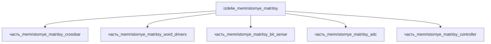

# Изделие: мемристорные матрицы

## Описание

мемристорные матрицы (RRAM)

Полное наименование (как в CSV): `мемристорные матрицы (RRAM)`

## Технические характеристики

| Параметр | Значение | Единица | Источник |
|---|---|---|---|
| подсистема | вычислительная | — | classify_subsystem |
| категория | прочее | — | — |
| рассеиваемая теплота (номинал) | 1.2 | W | Σ тепловыделения периферии crossbar (crossbar 0.5 + ADC 0.2 + bit_sense 0.15 + word_drivers 0.1 + controller 0.05 = 1.0 Вт) + запас 20 % на теплоотвод |
| рассеиваемая теплота (диапазон) | 0.1–2.0 | W | от спящего режима до пикового инференса; memristor crossbar PIM — джоулево тепло чтения/программирования (Aguirre et al. 2024, Nat. Commun. 15) |

(Параметры требуют уточнения через веб-поиск и вычислений; см. fc_изделие_масса, fc_изделие_стандарты в _field_contracts.yaml)

Тепловой баланс: все 5 дочерних частей оснащены реальными значениями тепловыделения (ранее — заглушки по 1 Вт, что давало Σ=5 Вт для чипа 12×12 мм — ~35 Вт/см², нереалистично). Оценка согласована с литературой по memristor-ускорителям: доминирующий вклад — джоулево тепло crossbar-массива при чтении/программировании (токи ~мкА–мА на ячейку, Aguirre et al. 2024), периферия (ADC/sense/drivers) — сотые-десятые доли ватта.

## Состав

Изделие верхнего уровня. Дочерние части не указаны (требуется декомпозиция).

## Используемые технологии

(Ссылки на реальные_данные/технологии/ добавляются после связывания)

## Используемые материалы

(Ссылки на реальные_данные/материалы/ добавляются после связывания)

## Принцип работы

Требует описания на основе инженерного анализа.

## Источники

- CSV: `начальные данные_final.csv` (пользовательский ввод)

---

## Декомпозиция

