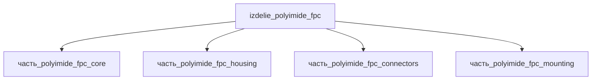

# Изделие: Polyimide FPC

## Описание

Polyimide FPC

Полное наименование (как в CSV): `Polyimide FPC`

## Технические характеристики

| Параметр | Значение | Единица | Источник |
|---|---|---|---|
| подсистема | прочее | — | classify_subsystem |
| категория | прочее | — | — |

(Параметры требуют уточнения через веб-поиск и вычислений; см. fc_изделие_масса, fc_изделие_стандарты в _field_contracts.yaml)

## Состав

Изделие верхнего уровня (уровень 1). Дочерние части: `часть_polyimide_fpc_core` (гибкая плата), `часть_polyimide_fpc_housing` (корпус), `часть_polyimide_fpc_connectors` (разъёмы), `часть_polyimide_fpc_mounting` (крепёж).

## Используемые технологии

(Ссылки на реальные_данные/технологии/ добавляются после связывания)

## Используемые материалы

(Ссылки на реальные_данные/материалы/ добавляются после связывания)

## Принцип работы

Требует описания на основе инженерного анализа.

## Источники

- CSV: `начальные данные_final.csv` (пользовательский ввод)

---

## Декомпозиция

