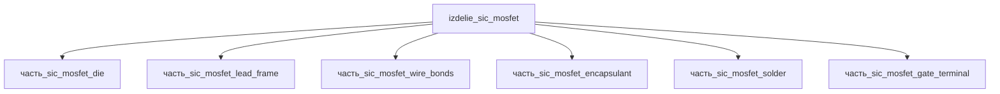

# Изделие: SiC MOSFET

## Описание

SiC MOSFET (Wolfspeed CPM3-9000)

Полное наименование (как в CSV): `SiC MOSFET (Wolfspeed CPM3-9000)`

Дискретный силовой SiC MOSFET в корпусе TO-247: монокристаллический 4H-SiC кристалл (часть_sic_mosfet_die, 5.5×4.5×0.18 мм) напаивается на die pad выводной медной рамки (часть_sic_mosfet_lead_frame, 15.5×20.5×0.6 мм, C11000 с Ni-барьером и Ag-пайкой), соединяется алюминиевыми проводниками (часть_sic_mosfet_wire_bonds) и затворным выводом (часть_sic_mosfet_gate_terminal), фиксируется на подложке слоем пайки (часть_sic_mosfet_solder, bondline 80 мкм) и защищается эпоксидным glob-top компаундом (часть_sic_mosfet_encapsulant, 8×8×1 мм). Габариты изделия — envelope корпуса TO-247 15.94×20.95×5.02 мм (Toshiba package dimensions; корроборация Vishay case outline TO-247AD).

## Технические характеристики

| Параметр | Значение | Единица | Источник |
|---|---|---|---|
| подсистема | вычислительная | — | classify_subsystem |
| категория | прочее | — | — |
| габариты (Д×Ш×В) | 15.94×20.95×5.02 | mm | Toshiba, TO-247 package dimensions; корроборация Vishay case outline TO-247AD 92825 |

## Состав

Изделие верхнего уровня (уровень 1), 6 дочерних частей уровня 2:

| Часть | Роль | Габариты, мм |
|---|---|---|
| часть_sic_mosfet_die | SiC кристалл (4H-SiC, монокристалл) | 5.5×4.5×0.18 |
| часть_sic_mosfet_solder | пайка кристалла к рамке (bondline 80 мкм) | 5.5×5.5×0.08 |
| часть_sic_mosfet_lead_frame | выводная рамка TO-247 (die pad + 3 вывода) | 15.5×20.5×0.6 |
| часть_sic_mosfet_wire_bonds | алюминиевые проводники затвора/истока | 5×0.3×0.3 |
| часть_sic_mosfet_gate_terminal | затворный вывод | 1×0.6×0.05 |
| часть_sic_mosfet_encapsulant | эпоксидный glob-top компаунд | 8×8×1 |

Габаритный баланс (F15g): V(parent)=1676.4 мм³ ≥ ΣV(детей)×1.15=301.3 мм³; по осям 15.94≥15.5, 20.95≥20.5, 5.02≥1.0 — все части помещаются внутри envelope корпуса.

## Используемые технологии

(Ссылки на реальные_данные/технологии/ добавляются после связывания)

## Используемые материалы

(Ссылки на реальные_данные/материалы/ добавляются после связывания)

## Принцип работы

Вертикальный траншейный SiC MOSFET: при положительном смещении затвора под затворным диэлектриком формируется инверсионный канал в 4H-SiC, ток течёт от истока через канал и дрейфовый эпитаксиальный слой к тыльному стоку (die pad рамки). Широкозонный SiC (критическое поле ~2.8 МВ/см, теплопроводность ~490 Вт/(м·К)) позволяет держать 1700 В блокировки при RDS(on) 25 мОм на кристалле 5.5×4.5 мм; тепло от кристалла отводится через пайку в медную рамку и фланец-Tab корпуса TO-247 на радиатор.

## Источники

- CSV: `начальные данные_final.csv` (пользовательский ввод)
- Toshiba, TO-247 package dimensions (15.94×20.95×5.02 мм): https://toshiba.semicon-storage.com/us/semiconductor/design-development/package/detail.TO-247.html (проверено 2026-11-06)
- Vishay, Case Outline for TO-247AD 3L (JEDEC TO-247AD — D 20.80–21.10, E 15.75–16.13, A 4.83–5.21 мм): https://www.vishay.com/docs/92825/packinfo_case_outline_to-247ad_3l.pdf (проверено 2026-11-08)

---

## Декомпозиция

