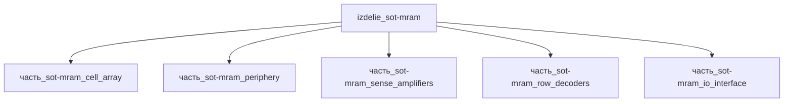

## Описание

SOT-MRAM

Полное наименование (как в CSV): `SOT-MRAM`

## Технические характеристики

| Параметр | Значение | Единица | Источник |
|---|---|---|---|
| подсистема | вычислительная | — | canon |
| подтип | память_MRAM | — | canon |
| масса | 0.001–0.01 (номинал 0.003) | kg | canon |
| габариты (Д×Ш×В) | 8×8×1 | mm | canon |
| выработка энергии | 0 | W | canon |
| выработка тепла | 0.01–0.1 | W | canon |
| тип узла | изделие | — | canon |
| уровень_номер | 1 | — | canon |

## Принцип работы

Требует описания на основе инженерного анализа.

## Состав

Изделие верхнего уровня. Дочерние части не указаны (требуется декомпозиция).

## Используемые технологии

- `cmos_7nm_intel4` (доля: 1.0)
- `cmos_7nm_intel4` (доля: 1.0)
- `cmos_7nm_intel4` (доля: 1.0)

## Используемые материалы

- `si` (форма: подложки_ис_и_мэмс) → [`si`](../../../материалы/si.md)
- `si` (форма: подложки_ис_и_мэмс) → [`si`](../../../материалы/si.md)
- `si` (форма: подложки_ис_и_мэмс) → [`si`](../../../материалы/si.md)

## Источники

- CSV: `начальные данные_final.csv` (пользовательский ввод)

---

## Декомпозиция

