# Изделие-обёртка: SkyNet-HKTank

## Описание

Wrapper-изделие для модели `SkyNet-HKTank` (тип: наземный_гусеничный, подсистема: каркас).

Создано для поддержки декомпозиции: дочерние части (часть_*) ссылаются на
этот id как на родителя. Сама модель остаётся в фантастические данные/модели/.

## Декомпозиция

```mermaid
graph TD
    HKTank["SkyNet-HKTank"]
    hk_tank_корпус["часть_hk_tank_корпус"]
    HKTank --> hk_tank_корпус
    hk_tank_гусеница_левая["часть_hk_tank_гусеница_левая"]
    HKTank --> hk_tank_гусеница_левая
    hk_tank_гусеница_правая["часть_hk_tank_гусеница_правая"]
    HKTank --> hk_tank_гусеница_правая
    hk_tank_башня["часть_hk_tank_башня"]
    HKTank --> hk_tank_башня
    hk_tank_плазма_пушка_1["часть_hk_tank_плазма_пушка_1"]
    HKTank --> hk_tank_плазма_пушка_1
    hk_tank_плазма_пушка_2["часть_hk_tank_плазма_пушка_2"]
    HKTank --> hk_tank_плазма_пушка_2
    hk_tank_сенсоры["часть_hk_tank_сенсоры"]
    HKTank --> hk_tank_сенсоры
    hk_tank_двигатель["часть_hk_tank_двигатель"]
    HKTank --> hk_tank_двигатель
    hk_tank_связь["часть_hk_tank_связь"]
    HKTank --> hk_tank_связь
    hk_tank_навигация["часть_hk_tank_навигация"]
    HKTank --> hk_tank_навигация
    hk_tank_боеприпасы["часть_hk_tank_боеприпасы"]
    HKTank --> hk_tank_боеприпасы
```

## Состав

Дочерние части:
- `часть_hk_tank_корпус`
- `часть_hk_tank_гусеница_левая`
- `часть_hk_tank_гусеница_правая`
- `часть_hk_tank_башня`
- `часть_hk_tank_плазма_пушка_1`
- `часть_hk_tank_плазма_пушка_2`
- `часть_hk_tank_сенсоры`
- `часть_hk_tank_двигатель`
- `часть_hk_tank_связь`
- `часть_hk_tank_навигация`
- `часть_hk_tank_боеприпасы`

## Связанная модель

- [`SkyNet-HKTank`](../../../фантастические%20данные/модели/) — модель SkyNet

## Источники

- Wrapper-изделие создано автоматически (2026-11-03) для поддержки декомпозиции
