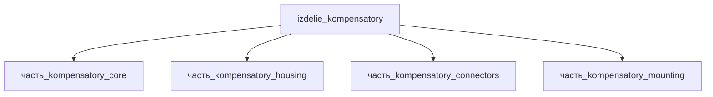

# Изделие: Компенсаторы

## Описание

Компенсаторы (compliant interposers)

Полное наименование (как в CSV): `Компенсаторы (compliant interposers)`

## Технические характеристики

| Параметр | Значение | Единица | Источник |
|---|---|---|---|
| подсистема | каркас | — | classify_subsystem |
| категория | прочее | — | — |

(Параметры требуют уточнения через веб-поиск и вычислений; см. fc_изделие_масса, fc_изделие_стандарты в _field_contracts.yaml)

## Состав

Изделие верхнего уровня (уровень 1, подсистема «каркас»). Дочерние части (4): `часть_kompensatory_core` (сильфон Inconel 718), `часть_kompensatory_housing` (корпус 6061-T6), `часть_kompensatory_connectors` (разъёмы), `часть_kompensatory_mounting` (фланцевый крепёж).

## Используемые технологии

- `ebw` → [`ebw.md`](../../../технологии/ebw.md) — `часть_kompensatory_core`: электронно-лучевая сварка в вакууме гофр сильфона (edge-welded технология: штампованные диафрагмы из тонкого листа свариваются по внутренним кромкам в пары → сильфонные гофры; EBW Inconel 718 — глубокое проплавление и качественный шов)
- `frezervanie_chpu` → [`frezervanie_chpu.md`](../../../технологии/frezervanie_chpu.md) — `часть_kompensatory_housing`: фрезерование на ЧПУ торцевых фланцев и корпуса из 6061-T6
- `anodirovanie` → [`anodirovanie.md`](../../../технологии/anodirovanie.md) — `часть_kompensatory_housing`: анодирование корпуса — коррозионная стойкость и износостойкие посадочные поверхности

## Используемые материалы

- `inconel_718` → [`inconel_718.md`](../../../материалы/inconel_718.md) — форма: `криогенная_техника` (часть_kompensatory_core, доля 0.45)
- `al_6061-t6` → [`al_6061-t6.md`](../../../материалы/al_6061-t6.md) — форма: `корпуса_электроники` (часть_kompensatory_housing, доля 0.27)

Обоснование вариантов материала: core — `криогенная_техника` (стандартное деформируемое состояние 718: закалка 1066 °C 1–2 ч + двойное старение 718/621 °C, рабочий диапазон −253…+704 °C): edge-welded сильфон собирается из тонколистовых штампованных диафрагм, свариваемых в отожжённом состоянии; Inconel 718 — штатный материал edge-welded сильфонов наряду с Inconel 625, Hastelloy C-276 и AM-350 (Metal Bellows Bellows 101), сильфоны expansion joints применяются в автоматике/контрольно-измерительных приборах, вакуумной технике, машиностроении и энергетике (Hy Nickel Alloy). housing — `корпуса_электроники`: фрезерованный корпус прибора из 6061-T6 (отраслевой стандарт корпусных деталей, анодирование).

## Принцип работы

Требует описания на основе инженерного анализа.

## Тепловой баланс

Сборка — пассивный сильфонный компенсатор (compliant interposer): собственное тепловыделение конструкции равно нулю, тепло генерируют только электрически нагруженные контакты разъёмов (часть_kompensatory_connectors, подтип «разъёмы»).

Расчёт Σ детей (F15b):
- core — 0 Вт (пассивная гофрированная оболочка Inconel 718, источников тепла нет; ранее — шаблонные 1 Вт, сняты 2026-11-07; Bellows Systems/FlexCom — пассивность сильфонных компенсаторов);
- housing — 0 Вт (пассивный корпус);
- connectors — 0.1 Вт: ohmic-нагрев контактов, P = I²R (силовой контакт ~7.3 мОм @ 7.5 А → 0.41 Вт/контакт — Lectromec; для маломощного набора разъёмов с частично нагруженным силовым контактом Σ ≈ 0.1 Вт);
- mounting — 0 Вт (фланцевый крепёж).

Σ(детей) = 0.1 Вт ≤ номинал родителя 0.1 Вт → F15b PASS (собственное тепловыделение компенсатора 0, максимум 0.2 Вт — резерв на деградацию контактов ×2).

Ранее родитель имел 0 Вт при Σ детей 1.10 Вт (шаблонная 1 Вт у core + 0.1 Вт разъёмы) — нарушение F15b (issue #770).

## Источники

- CSV: `начальные данные_final.csv` (пользовательский ввод)
- Metal Bellows: Bellows 101 — How are Edge-Welded Metal Bellows Manufactured? (штамповка диафрагм из тонкого листа, сварка пар в гофры precision laser/micro-TIG; материалы edge-welded сильфонов — Inconel 625/718, Hastelloy C-276, AM-350): http://www.metalbellows.com/bellows-101 (обращение 2026-11-08)
- Flexaseal: What are Edge Welded metal bellows? — микросварка внутренних кромок штампованных диафрагм в двухгофровые пары: https://www.flexaseal.com/what-are-edge-welded-metal-bellows (обращение 2026-11-08)
- Coupling Tips: The Technology behind Edge Welded Metal Bellows — сварка штампованных диафрагм в длинную гибкую сборку, ключ к характеристикам — параллельность гофр: http://www.couplingtips.com/bellows-couplings/the-technology-behind-edge-welded-metal-bellows (обращение 2026-11-08)
- ResearchGate: Electron Beam Welding of Inconel 718 (EBW IN718 — глубокое проплавление и высокое качество шва, aerospace): https://www.researchgate.net/publication/342401170_Electron_Beam_Welding_of_Inconel_718 (обращение 2026-11-08)
- Hy Nickel Alloy: Summary of commonly used metal materials for bellows expansion joints — материалы сильфонных компенсаторов, области применения (автоматика и КИП, вакуумная техника, машиностроение, энергетика): https://hynickelalloy.com/blog/summary-of-commonly-used-metal-materials-for-bellows-expansion-jointshy-technic (обращение 2026-11-08)
- Материал-вариант криогенной техники 718 (закалка 1066 °C + двойное старение, −253…+704 °C): High Temp Metals Inconel 718 data — https://www.hightempmetals.com/techdata/hitempInconel718data.php (см. реальные данные/материалы/inconel_718.md)
- Контактное сопротивление разъёмов и ohmic-нагрев (7.3 мОм @ 7.5 А → 0.41 Вт/контакт) — https://lectromec.com/blog/connector-contact-resistance (обращение 2026-11-07)
- Пассивность сильфонных компенсаторов — https://www.bellows-systems.com/metal-expansion-joints (обращение 2026-11-07)

---

## Декомпозиция

