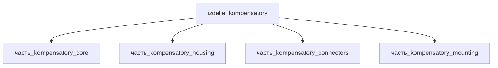

# Изделие: Компенсаторы

## Описание

Компенсаторы (compliant interposers)

Полное наименование (как в CSV): `Компенсаторы (compliant interposers)`

## Технические характеристики

| Параметр | Значение | Единица | Источник |
|---|---|---|---|
| подсистема | каркас | — | classify_subsystem |
| категория | прочее | — | — |

(Параметры требуют уточнения через веб-поиск и вычислений; см. fc_изделие_масса, fc_изделие_стандарты в _field_contracts.yaml)

## Состав

Изделие верхнего уровня. Дочерние части не указаны (требуется декомпозиция).

## Используемые технологии

(Ссылки на реальные_данные/технологии/ добавляются после связывания)

## Используемые материалы

(Ссылки на реальные_данные/материалы/ добавляются после связывания)

## Принцип работы

Требует описания на основе инженерного анализа.

## Тепловой баланс

Сборка — пассивный сильфонный компенсатор (compliant interposer): собственное тепловыделение конструкции равно нулю, тепло генерируют только электрически нагруженные контакты разъёмов (часть_kompensatory_connectors, подтип «разъёмы»).

Расчёт Σ детей (F15b):
- core — 0 Вт (пассивная гофрированная оболочка Inconel 718, источников тепла нет; ранее — шаблонные 1 Вт, сняты 2026-11-07; Bellows Systems/FlexCom — пассивность сильфонных компенсаторов);
- housing — 0 Вт (пассивный корпус);
- connectors — 0.1 Вт: ohmic-нагрев контактов, P = I²R (силовой контакт ~7.3 мОм @ 7.5 А → 0.41 Вт/контакт — Lectromec; для маломощного набора разъёмов с частично нагруженным силовым контактом Σ ≈ 0.1 Вт);
- mounting — 0 Вт (фланцевый крепёж).

Σ(детей) = 0.1 Вт ≤ номинал родителя 0.1 Вт → F15b PASS (собственное тепловыделение компенсатора 0, максимум 0.2 Вт — резерв на деградацию контактов ×2).

Ранее родитель имел 0 Вт при Σ детей 1.10 Вт (шаблонная 1 Вт у core + 0.1 Вт разъёмы) — нарушение F15b (issue #770).

## Источники

- CSV: `начальные данные_final.csv` (пользовательский ввод)
- Контактное сопротивление разъёмов и ohmic-нагрев (7.3 мОм @ 7.5 А → 0.41 Вт/контакт) — https://lectromec.com/blog/connector-contact-resistance (обращение 2026-11-07)
- Пассивность сильфонных компенсаторов — https://www.bellows-systems.com/metal-expansion-joints (обращение 2026-11-07)

---

## Декомпозиция

