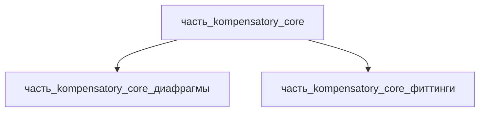

# Часть: часть_kompensatory_core

## Описание

Сильфонный компенсатор (edge-welded bellows) — упругая гофрированная секция Inconel 718: компенсация теплового расширения и вибрации трубопроводов при высоких температурах. Референсное исполнение — edge-welded сильфонный узел Ø90 (AMS 5662, деформируемое состояние криогенная_техника: закалка 1066 °C + двойное старение). Габариты 90×90×35 мм, масса 0.25 кг — паспортные данные (компенсатор теплового расширения). Конструкция: 7 гофр из 14 штампованных диафрагм Ø88 (фольга 0.15 мм), приваренных EBW к 2 концевым кольцам Ø90×8.

Родитель: `izdelie_kompensatory` (подсистема: каркас).

## Технические характеристики

| Параметр | Значение | Единица | Источник |
|---|---|---|---|
| подсистема | каркас | — | canon |
| подтип | основной_элемент | — | canon |
| масса | 0.25 | kg | компенсатор теплового расширения (сильфонный узел Ø90, Inconel) |
| доля массы родителя | 0.5 | — | canon |
| габариты (Д×Ш×В) | 90×90×35 | mm | компенсатор теплового расширения (сильфонный узел Ø90, Inconel) |
| выработка энергии | 0 | W | canon |
| выработка тепла | 0 | W | пассивная механическая конструкция (web_search 2026-11-07) |
| материал | inconel_718 (форма: криогенная_техника) | — | компенсатор теплового расширения (сильфонный узел Ø90, Inconel); inconel_718.md |
| состав | 2 части уровня 3: диафрагмы (комплект 14), фиттинги (комплект 2) | — | декомпозиция СТРАТЕГИЯ B (web search 2026-11-08) |

## Принцип работы

Определяется типом и назначением родительского изделия.

## Тепловыделение

Сильфонный компенсатор — чисто пассивное механическое устройство: гофрированная оболочка Inconel 718 компенсирует осевые/угловые/сдвиговые перемещения и вибрацию трубопроводов (Bellows Systems, FlexCom, Victaulic — каталоги производителей). Внутри сильфона нет источников тепла: ни электроники, ни двигателей, ни резистивных элементов — устройство энергию не преобразует.

Функция сильфона по теплу — пассивная термостойкость: Inconel 718 выбран ради высокотемпературной стойкости среды, а не тепловыделения. Ранее указанное 1 Вт — шаблонная каноническая заглушка без физического обоснования (снята 2026-11-07, issue #770).

Баланс тепла сборки (F15b): Σ(детей) = 0.1 Вт (ohmic-нагрев контактов разъёмов) ≤ родитель 0.1 Вт → PASS. См. расчёт в родительском `_index.md`.

## Состав

Промежуточная часть (уровень 2) — edge-welded сильфон, декомпозирована на 2 неделимых узла уровня 3 (Σ масс 0.105+0.145 = 0.250 кг, доли 0.42+0.58 = 1.0):

- `часть_kompensatory_core_диафрагмы` — комплект 14 штампованных диафрагм Ø88×2 мм (фольга Inconel 718 0.15 мм), свариваются EBW попарно по внутренним кромкам → 7 гофр;
- `часть_kompensatory_core_фиттинги` — комплект 2 концевых колец Ø90×Ø82×8 мм (Inconel 718, фрезерование ЧПУ), замыкают торцы гофр, воспринимают осевую нагрузку.

## Используемые материалы

- `inconel_718` → [`inconel_718.md`](../../../../материалы/inconel_718.md) — жаропрочный сплав Inconel 718

## Источники

- компенсатор теплового расширения (сильфонный узел Ø90, Inconel) — https://en.wikipedia.org/wiki/Expansion_joint (обращение 2026-11-05)
- Metal Expansion Joints (пассивность, применение, материалы) — https://www.bellows-systems.com/metal-expansion-joints (обращение 2026-11-07)
- FlexCom — Metal Bellows Expansion Joints (компенсация перемещений/вибраций) — https://www.flexcomonline.com/products/metal-bellows-expanion-joints (обращение 2026-11-07)
- MW Components: Edge Welded Bellows — стандартные и заказные edge-welded сильфоны (штамповка диафрагм, сварка секции, концевые фиттинги): https://mwcomponents.com/edge-welded-bellows (обращение 2026-11-08)
- Канон: декомпозиция `izdelie_kompensatory` (web search 2026-11-03)
- Материалы: реальные данные/материалы/
