# Изделие-обёртка: SkyNet-MarcusWright

## Описание

Wrapper-изделие для модели `SkyNet-MarcusWright` (тип: гуманоидный, подсистема: каркас).

Создано для поддержки декомпозиции: дочерние части (часть_*) ссылаются на
этот id как на родителя. Сама модель остаётся в фантастические данные/модели/.

## Декомпозиция

```mermaid
graph TD
    MarcusWright["SkyNet-MarcusWright"]
    marcus_человеческий_мозг["часть_marcus_человеческий_мозг"]
    MarcusWright --> marcus_человеческий_мозг
    marcus_эндоскелет["часть_marcus_эндоскелет"]
    MarcusWright --> marcus_эндоскелет
    marcus_сердце_гибрид["часть_marcus_сердце_гибрид"]
    MarcusWright --> marcus_сердце_гибрид
    marcus_топливная_ячейка["часть_marcus_топливная_ячейка"]
    MarcusWright --> marcus_топливная_ячейка
    marcus_рука_левая["часть_marcus_рука_левая"]
    MarcusWright --> marcus_рука_левая
    MarcusWright --> marcus_рука_правая
    marcus_нога_левая["часть_marcus_нога_левая"]
    MarcusWright --> marcus_нога_левая
    MarcusWright --> marcus_нога_правая
    marcus_человеческое_сердц["часть_marcus_человеческое_сердце"]
    MarcusWright --> marcus_человеческое_сердц
    marcus_человеческая_кожа["часть_marcus_человеческая_кожа"]
    MarcusWright --> marcus_человеческая_кожа
```

## Состав

Дочерние части:
- `часть_marcus_человеческий_мозг`
- `часть_marcus_эндоскелет`
- `часть_marcus_сердце_гибрид`
- `часть_marcus_топливная_ячейка`
- `часть_marcus_рука_левая`
- `часть_marcus_нога_левая`
- `часть_marcus_человеческое_сердце`
- `часть_marcus_человеческая_кожа`

## Связанная модель

- [`SkyNet-MarcusWright`](../../../фантастические%20данные/модели/) — модель SkyNet

## Источники

- Wrapper-изделие создано автоматически (2026-11-03) для поддержки декомпозиции
