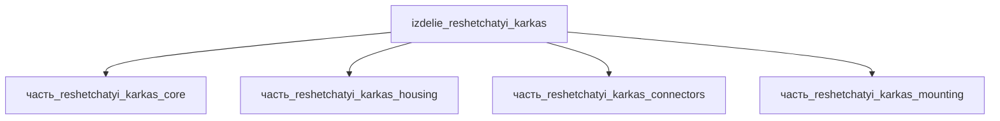

# Изделие: Решётчатый каркас

## Описание

Решётчатый каркас (SLM + HIP)

Полное наименование (как в CSV): `Решётчатый каркас (SLM + HIP)`

## Технические характеристики

| Параметр | Значение | Единица | Источник |
|---|---|---|---|
| подсистема | каркас | — | classify_subsystem |
| категория | прочее | — | — |
| габариты (Д×Ш×В) | 530×500×500 | mm | F15g: конверт вокруг кожуха 518×437×230 + торцевые монтажные узлы ~12 мм |
| масса | 50 (1–1000) | kg | canon |
| выработка тепла | 0.1 (0–0.2) | W | canon/расчёт #767 (ohmic-нагрев контактов разъёмов) |

(Параметры требуют уточнения через веб-поиск и вычислений; см. fc_изделие_масса, fc_изделие_стандарты в _field_contracts.yaml)

## Состав

Изделие верхнего уровня (уровень 1). Дочерние части:

- `часть_reshetchatyi_karkas_core` — сотовая несущая решётка Al 6061-T6 (SLM+HIP), 450×380×200 мм;
- `часть_reshetchatyi_karkas_housing` — кожух Ti-6Al-4V (ASTM B348/AMS 4928), 518×437×230 мм — габаритообразующий;
- `часть_reshetchatyi_karkas_connectors` — разъёмы (IEC 60603 / MIL-DTL-38999), 106×94×45 мм;
- `часть_reshetchatyi_karkas_mounting` — кронштейны (EN 1090-2 / ISO 898-1), 150×150×12 мм.

Габаритный баланс (F15g): ΣV(детей) = 86 982 560 мм³ × 1.15 = 100 029 944 ≤ V(родителя) = 530×500×500 = 132 500 000 мм³ (коэффициент 1.52); по осям: 530 ≥ 518 (кожух + 12 мм торцевые монтажные узлы), 500 ≥ 437, 500 ≥ 230 ✓

## Используемые технологии

(Ссылки на реальные_данные/технологии/ добавляются после связывания)

## Используемые материалы

(Ссылки на реальные_данные/материалы/ добавляются после связывания)

## Принцип работы

Решётчатый каркас — аддитивно изготовленная несущая конструкция (SLM — selective laser melting + HIP — горячее изостатическое прессование, Ti-6Al-4V/Al-заготовки): топологически оптимизированная решётчатая/сотовая структура воспринимает эксплуатационные нагрузки, минимизируя массу (аэрокосмическое применение, TRL 9 для PBF-LB Ti-6Al-4V). Внутри каркаса размещается кожух (габаритообразующая часть 518×437×230 мм) с сотовым наполнением, разъёмы выведены на боковую поверхность, кронштейны крепят каркас к несущей плоскости. Конвенция упаковки: длина каркаса = длина кожуха + торцевые монтажные зоны под кронштейны/заглушки (~12 мм), ширина/высота — с запасом на крепёж по бокам.

## Тепловой баланс

Сборка — пассивная несущая рама (SLM + HIP): собственное тепловыделение конструкции равно нулю, тепло генерируют только электрически нагруженные контакты разъёмов (часть_reshetchatyi_karkas_connectors, 24-pin mixed signal + power).

Расчёт Σ детей (F15b):
- core — 0 Вт (пассивная сотовая Al 6061-T6, источников тепла нет; ранее — шаблонные 1 Вт, сняты 2026-11-07);
- housing — 0 Вт (пассивный кожух);
- connectors — 0.1 Вт: ohmic-нагрев контактов, P = I²R. Типовое контактное сопротивление силового контакта ~7.3 мОм (Lectromec: 55 мВ при 7.5 А → 0.41 Вт на контакт); сигнальные контакты (десятки мА) — пренебрежимо. Для набора из 24 контактов mixed signal+power с единичным силовым контактом, нагруженным частично: Σ ≈ 0.1 Вт;
- mounting — 0 Вт (кронштейны).

Σ(детей) = 0.1 Вт ≤ номинал родителя 0.1 Вт → F15b PASS (собственное тепловыделение рамы 0, максимум 0.2 Вт — резерв на деградацию контактов ×2).

Ранее родитель имел 0 Вт при Σ детей 1.10 Вт (шаблонная 1 Вт у core + 0.1 Вт разъёмы) — нарушение F15b (issue #767).

## Источники

- CSV: `начальные данные_final.csv` (пользовательский ввод)
- Контактное сопротивление разъёмов и ohmic-нагрев (7.3 мОм @ 7.5 А → 0.41 Вт/контакт) — https://lectromec.com/blog/connector-contact-resistance (обращение 2026-11-07)
- Пассивность несущих сотовых/изогрид-конструкций — https://www.beyondgravity.com/en/satellites/mechanical-solutions/satellite-structures (обращение 2026-11-07)
- S. Valencia et al., «Additive Manufacturing of Structural Components for Aerospace» (MDPI Aerospace, 2026): Ti-6Al-4V Grade 5 — доминирующий сплав PBF-LB/PBF-EB, TRL 9 — https://www.mdpi.com/2226-4310/13/8/698 (обращение 2026-11-08)

---

## Декомпозиция

