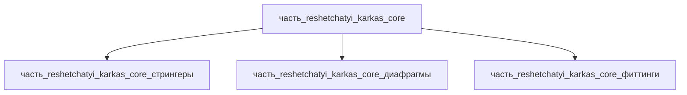

# Часть: часть_reshetchatyi_karkas_core

## Описание

Решетчатый каркас (core) — ферменная несущая структура 450×380×200 мм, масса 2.5 кг, Al 6061-T6: пространственная решётка из трубчатых стрингеров, связанных торцевыми перфорированными диафрагмами через узловые фиттинги (классическая трубчатая ферма со сварными/болтовыми узлами — архитектурный класс спутниковых truss-структур). Декомпозирован (СТРАТЕГИЯ B, F34): 3 неделимых узла уровня 3 — стрингеры (прокатный профиль ASTM B241), диафрагмы (лист ASTM B209, фрезеровка ЧПУ), фиттинги (ASTM B247, CNC).

Родитель: `izdelie_reshetchatyi_karkas` (подсистема: каркас).

## Технические характеристики

| Параметр | Значение | Единица | Источник |
|---|---|---|---|
| подсистема | каркас | — | canon |
| подтип | основной_элемент | — | canon |
| масса | 2.5 | kg | декомпозиция: 0.79 (стрингеры) + 1.14 (диафрагмы) + 0.57 (фиттинги) = 2.50 кг; каркас 450×380×200 класс Spacecraft bus |
| доля массы родителя | 0.5 | — | canon |
| габариты (Д×Ш×В) | 450×380×200 | mm | решетчатый каркас (сотовая конструкция 450×380×200, оценка); стрингеры протянуты по оси 450, диафрагмы в сечении 440×370 (зазор на фиттинги) |
| выработка энергии | 0 | W | canon |
| выработка тепла | 0 | W | пассивная несущая конструкция (web_search 2026-11-07) |
| материал | al_6061-t6 (форма: силовые_элементы_конструкций) | — | al_6061-t6.md (ASTM B221/B209/B241) |
| наследуемые материалы | al_6061-t6 / силовые_элементы_конструкций — 1.0 | — | наследуемые_материалы (BOM детей) |
| декомпозиция | 3 части: стрингеры / диафрагмы / фиттинги (уровень 3) | — | F34 СТРАТЕГИЯ B |

## Принцип работы

Ферменная схема: осевые усилия (растяжение/сжатие) несут трубчатые стрингеры, торцевые диафрагмы замыкают контур решётки и воспринимают сдвиг/кручение, узловые фиттинги концентрируют сходящиеся усилия стержней и передают их на диафрагмы (узел не слабее стержня). Al 6061-T6 (σ_0.2 ≈ 270 МПа, ρ 2.70 г/см³) даёт высокую удельную жёсткость; перфорация диафрагм (заполнение 65 %) снижает массу при сохранении сдвиговой жёсткости — принцип сотовых/изогрид панелей спутниковых платформ (Beyond Gravity, NASA SST-SOA §7.0).

## Тепловыделение

Ядро — пассивная несущая сотовая/стрингерная конструкция из Al 6061-T6 (фрезерованный изогрид или аддитивный SLM+HIP): внутри отсутствуют источники тепла (двигатели, электроника, резистивные элементы). Ранее указанное значение 1 Вт было шаблонной канонической заглушкой и не имело физического обоснования.

Функция ядра по теплу — проводящая, а не генерирующая: сотовые/изогрид-панели спутниковых платформ (Beyond Gravity — Satellite Structure Panels; NASA SST-SOA, раздел 7.0 Thermal Control) только проводят и рассеивают тепло от смонтированного оборудования, сам материал конструкции тепло не выделяет.

Баланс тепла сборки (F15b): Σ(детей) = 0.1 Вт (ohmic-нагрев контактов разъёмов часть_reshetchatyi_karkas_connectors) ≤ родитель 0.1 Вт → PASS. См. расчёт в родительском `_index.md`.

## Состав

Промежуточная часть (уровень 2): 3 неделимых узла уровня 3 — стрингеры (8 трубок 15×15×1.5×450 мм ASTM B241, 0.79 кг), диафрагмы (2 перфорированные рамки 440×370×2 мм ASTM B209, 1.14 кг), фиттинги (16 узловых бобышек 32×32×28 мм ASTM B247, 0.57 кг). Σ = 2.50 кг = масса core; доли 0.316/0.456/0.228.

## Используемые материалы

- `al_6061-t6` → [`al_6061-t6.md`](../../../../материалы/al_6061-t6.md) — конструкционный алюминиевый сплав 6061-T6

## Источники

- решетчатый каркас (сотовая конструкция 450×380×200, оценка) — https://en.wikipedia.org/wiki/Spacecraft_bus (обращение 2026-11-08)
- J. Liu (2025) — Satellite Truss Structure–Equipment–Process integrated design (Springer): https://link.springer.com/chapter/10.1007/978-981-95-2405-1_23 (проверено 2026-11-08)
- Пассивные сотовые/изогрид-панели спутниковых конструкций — https://www.beyondgravity.com/en/satellites/mechanical-solutions/satellite-structures (обращение 2026-11-08)
- NASA SST State-of-the-Art, раздел 7.0 Thermal Control (пассивные системы) — https://www.nasa.gov/smallsat-institute/sst-soa/thermal-control (обращение 2026-11-07)
- Канон: декомпозиция `izdelie_reshetchatyi_karkas` (web search 2026-11-03)
- Материалы: реальные данные/материалы/

## Декомпозиция

